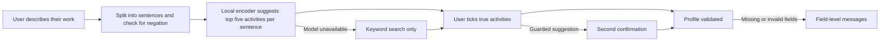

<div align="center">


# AIVANCIN

### From the work you already do to the closest graduate roles, for underemployed Malaysian graduates.

You describe what you actually do, in your own words. An AI suggests the matching work activities, you confirm the ones that are true, and AIVANCIN shows the closest graduate-level roles that use that work, what each still requires, what AI is already doing in those tasks, and a free, verified plan for the gaps.

<sub>Built for SDC Hackathon 2026 · Team DOVUN · Domain One: The Aiversecity Future-Ready Workforce Domain</sub>

**[Run locally](#how-to-run)** · Live demo and demo video: not yet available

</div>

## Team Information

| Field | Details |
| --- | --- |
| **Team Name** | DOVUN |
| **Team Domain** | Domain 1: The Aiversecity Future-Ready Workforce Domain |
| **SDG Track (1-17)** | SDG 8: Decent Work and Economic Growth (target 8.5) |
| **Team Leader** | Jad Fahmi |
| **University** | German-Malaysian Institute |
| **Number of Members** | 5 |

## Links

| Resource | Link |
| --- | --- |
| GitHub Repository | https://github.com/AIVANCIN/aivancin |
| Replit Project | Not yet available |
| Live Demo | Not yet available |
| RunPod Endpoint | Not yet available |
| Slide Deck | Not yet available |
| Demo Video | Not yet available |

---

## Overview

> **The problem:** many Malaysian graduates work in jobs below their qualification, and before spending evenings and savings on retraining they cannot easily see which graduate-level job is closest to what they already do.  
> **Our approach:** read the user's own description of their work, suggest the matching O\*NET work activities with a local AI model, let the user confirm each one, then match roles by activity overlap.  
> **The result today:** the intake engine works end to end through an API: free text in, activity suggestions with the sentence that triggered each, a guard against "I have never..." statements, and a confirmed profile out. Role matching and the web interface are not built yet.

| Snapshot | Details |
| --- | --- |
| **Who it's for** | A Malaysian diploma or degree holder aged 25-34 working in a semi- or low-skilled job (for example a van driver, cashier or call-centre agent), before committing to retraining |
| **What works now** | Intake: activity suggestions, guard, confirmation, manual search, job title activities, validation and the AI-unavailable fallback (API only) |
| **Demo mode** | Model inference runs live on the CPU from bundled files; data are bundled, dated snapshots; personas are synthetic |
| **Reviewed revision** | Checks below were run on 20 October 2026 (Windows 11, Python 3.13) |

### Problem

In Q2 2026, 40.7% of employed tertiary-educated Malaysians aged 25-34 (751,100 people) worked in semi- or low-skilled jobs ([DOSM `lfs_qtr_sru_age`](https://storage.dosm.gov.my/labour/lfs_qtr_sru_age.csv), CC BY 4.0). Take Hafiz, a synthetic persona: 27, computing diploma, van driver. Searching by his job title points to vehicle-operator roles. His weekends tell a different story: he fixes friends' laptops and wifi, installs software, makes backups and keeps his uncle's shop website updated. That is the work that leads towards graduate roles, and job-title tools never see it.

**What people do today.** A general chatbot can suggest plausible roles and even cite AI-usage figures, but its narrative advice varies between runs and does not show which recorded activities the match rests on. Skills platforms such as MyMahir ask the user to pick a target role first.

**What it does not solve here.** Turning casual descriptions of side work into checkable, confirmed activity evidence, and ranking roles reproducibly from that evidence.

**Challenge alignment.** Domain One asks for skills intake, an AI-trend signal layer, future-role matching, a reskilling pathway, SDG mapping and handling of uncertainty. This first part delivers the skills intake. The SDG link is target 8.5 (productive employment and decent work for young people) through the skill-level step of each role, with target 4.4 (relevant skills) on each skill.

### Solution

The AI is a local sentence encoder, all-MiniLM-L6-v2 (quantized ONNX, about 23 MB, run on the CPU with ONNX Runtime). Each sentence the user writes is encoded and compared with precomputed vectors for all 2,087 O\*NET 31.0 detailed work activities; the five closest are suggested, each with the sentence that triggered it. The AI only suggests: nothing enters the profile until the user ticks it, and suggestions that come only from a negated or aspirational sentence need a second, deliberate confirmation. Everything after the confirmed profile (matching, labels, plans) is deterministic. No generative model runs in the product, and no training or fine-tuning has been done yet.

### Key Features

- **Activity suggestions from your own words:** "I install software and clean out viruses" suggests "Install computer software" and "Resolve computer software problems", with the sentence highlighted by character offsets.
- **Nothing accepted silently:** every activity needs an explicit tick; "I have never repaired a laptop" puts its suggestions under a second confirmation; the server rejects activities the model never suggested.
- **Works when the AI does not:** if the model, tokenizer or vectors are missing or do not match their recorded hashes, the API says AI suggestions are unavailable and keyword search keeps working.
- **Reproducible data:** every dataset and the model are bundled with their source, release date, licence and SHA-256 hashes; the same input always gives the same suggestions.

## See it in action

A demo video is not yet available. The same walkthrough runs against the local API ([start it first](#how-to-run)):

1. **Start:** load the synthetic persona Hafiz: `curl http://127.0.0.1:8000/api/personas`
2. **Watch:** send his text to the encoder: `POST /api/suggest` with `current_job`, `other_work` and `studies`. Each of his 9 sentences returns its top five activities; "On weekends I fix my friends' laptops and set up their home wifi" includes "Resolve computer network problems".
3. **Decide:** pick the activities that are true and send them with hours, budget and degree level to `POST /api/profile`.
4. **Finish:** the response is the confirmed profile, with each activity's source (suggested, added by you, or from the job title) and lane (current job, other work, studies), or field-level messages if something is missing.

**Try the same scenario:** open `http://127.0.0.1:8000/docs` and use the interactive forms, or the commands above.

**When something goes wrong:** send `{"weekly_hours": 0}` to `/api/profile` and the response lists a message for each invalid field; remove `data/model/model.onnx` and `/api/status` reports AI suggestions as unavailable while search still works.

## How it works



| Stage | What the user does | What the product actually does |
| --- | --- | --- |
| **1 · Begin** | Writes about the current job, other work and studies, or loads a persona | Splits the text into sentences with offsets; flags negated or aspirational sentences |
| **2 · Process** | Waits (tens of milliseconds) | Encodes each sentence and ranks all 2,087 activities by cosine similarity |
| **3 · Review** | Ticks the true activities, searches for missing ones, unticks job title activities | Shows each activity once with every sentence that triggered it |
| **4 · Complete** | Submits hours, budget and degree level | Recomputes the suggestions server-side, enforces the guard and returns the confirmed profile |

### What makes this approach different

| For this task | Keyword search | AIVANCIN |
| --- | --- | --- |
| **Casual wording** | Needs the catalogue's own words | Matches by meaning: "back up their phones and laptops to external drives" suggests "Create electronic data backup to prevent loss of information" |
| **Wrong suggestions** | Accepted or ignored without trace | Every activity is confirmed by the user, with the triggering sentence shown |

**Trade-off:** the user has to review suggestions, and the model and vectors add about 26 MB to the repository.

## What is implemented

| Capability | Current status | How to verify |
| --- | --- | --- |
| Activity suggestions from free text | WORKING (API) | `tests/test_intake.py`, `POST /api/suggest` |
| Guard, confirmation and validation | WORKING (API) | `tests/test_intake.py`, `POST /api/profile` |
| AI-unavailable fallback | WORKING (API) | `tests/test_app_and_failures.py` |
| O\*NET 31.0 and model snapshots | CACHED (bundled, hashed) | `data/manifest.json`, `python tools/build_snapshots.py` |
| Role matching, requirement labels | NOT IMPLEMENTED | |
| AI-usage evidence, scenarios, pathway, SDG mapping | NOT IMPLEMENTED | |
| Web interface | NOT IMPLEMENTED | |

**Boundary:** AIVANCIN does not judge proficiency from text, forecast jobs or say whether a role is reachable. It reads only what the user writes and never stores it.

## Evidence and limitations

The intake engine behaves as specified on the bundled data; whether it helps real users has not been tested.

| What we checked | Observation | Reproduction and limits |
| --- | --- | --- |
| **Core path and recovery** | PASS, 36/36 tests | `python -m pytest`, 20 Oct 2026, Windows 11, Python 3.13; network access blocked during tests; includes missing, altered and mismatched model files |
| **Improvement against a baseline** | NOT RUN | A comparison with keyword search on fresh descriptions is planned |
| **Usability with target users** | NOT RUN | Personas and test sentences are synthetic |
| **Speed** | 45 ms for Hafiz's 9 sentences, model already loaded | One run on a laptop CPU; Replit not measured |

**What we can conclude:** suggestions, guard, confirmation and fallback work as designed on the bundled data and synthetic text.  
**What we cannot conclude yet:** suggestion accuracy on real users' descriptions, matching quality, or any benefit to users.

**Known limitations:**

- **English only:** Malay text is not supported.
- **Idioms can miss:** "I keep the books" does not surface a bookkeeping activity in the top five; the user can add it by keyword search.
- **Guard is a word list:** it works per sentence, so "I don't just drive, I also fix laptops" is flagged and needs the second confirmation.

### Tech Stack

| Layer | Technology | Responsibility |
| --- | --- | --- |
| Frontend | None yet | Interactive API docs at `/docs` |
| Backend | Python 3.13, FastAPI 0.150, Uvicorn 0.54 | Intake API and validation |
| Database | None; bundled CSV and NumPy files | O\*NET extracts, activity vectors, manifest |
| AI / Compute | all-MiniLM-L6-v2 (ONNX) on CPU with ONNX Runtime 1.31 and Tokenizers 0.23 | Sentence encoding for activity suggestions |
| Hosting / Dev | Replit (not yet deployed) | Planned deployment |

### Privacy, safety and reliability

- **Data:** text is processed in memory for the request and not stored or logged by the app. There are no accounts. Demo personas are synthetic.
- **Sharing:** none. The app makes no network requests; the model runs locally.
- **Security:** inputs are validated server-side, and the server recomputes suggestions rather than trusting the client. No secrets are needed or stored.
- **Failure behaviour:** a missing or altered model, tokenizer or vector file switches to keyword search with a clear message; an altered dataset file stops the app at start-up rather than serving wrong data.

---

## Project Structure

```
.
├── assets/icon/            # App icon
├── data/                   # Bundled snapshots: manifest.json, onet/, model/, vectors/, personas.json
├── src/
│   ├── main.py             # Application entry point
│   └── aivancin/           # snapshots.py, encoder.py, intake.py, app.py
├── submission/             # Required submission documents (added before the deadline)
├── tests/                  # Offline tests
├── tools/
│   └── build_snapshots.py  # Rebuilds data/ from the original sources
├── .env.example            # Optional HOST and PORT
├── .gitignore
├── .replit                 # Replit run configuration
├── LICENSE
├── pyproject.toml          # Test configuration
├── requirements.txt        # Runtime dependencies
├── requirements-dev.txt    # Runtime plus test dependencies
└── README.md
```

### Architecture

```
User ──► FastAPI app (src/main.py) ──► intake: sentence split, guard, validation
                │                          │
                │                          └──► local encoder (ONNX, CPU) + bundled activity vectors
                └──► JSON response returned to user
```

Running the encoder locally on precomputed vectors keeps the demo offline, free and reproducible: there is no API key, no per-request cost and no external service to fail.

---

## How to Run

### Option 1: Run on Replit (Recommended)

1. Import this repository via **Create Repl → Import from GitHub**.
2. No secrets are needed.
3. Click **Run**. Replit uses `.replit` to start `python src/main.py`.

Not yet verified on Replit.

### Option 2: Run Locally

**Prerequisites:** Python 3.13 (other recent versions untested). No accounts, keys or paid services.  
**Verified on:** a fresh clone, Windows 11, Python 3.13, 20 October 2026.

```bash
git clone https://github.com/AIVANCIN/aivancin.git
cd aivancin
python -m venv venv
source venv/bin/activate        # Windows: venv\Scripts\activate
pip install -r requirements.txt
python src/main.py
```

Open **http://127.0.0.1:8000/docs**. Load the synthetic personas from `GET /api/personas`.

### Run Tests

```bash
pip install -r requirements-dev.txt
python -m pytest
```

**Expected result:** `36 passed`. Tests run offline; outbound network access is blocked.  
**Rebuild the data (optional):** `python tools/build_snapshots.py` downloads the original files into `.cache/` and reproduces `data/` byte for byte.

---

## How We Use Replit *(Required)*

Not used yet. The app is prepared for Replit: `.replit` starts `python src/main.py`, which binds to all interfaces on Replit, and everything it needs is bundled, so a deployment needs no secrets or external services. The deployment URL and proof of use will be added here.

## How We Use RunPod *(Required)*

Not used yet. The planned GPU workload is fine-tuning the sentence encoder on O\*NET's 24,087 task-to-activity links. The fine-tuned model ships only if it beats the base model on held-out casual descriptions written before training; otherwise the base model stays.

---

## Challenges & Learnings

- **Unreliable downloads:** the O\*NET server sometimes cut large files short, so the snapshot builder checks the length and falls back to byte-range downloads.
- **Hashes and line endings:** Git on Windows rewrote line endings in hashed data files; `.gitattributes` now keeps `data/` byte-exact so the hash checks hold on every checkout.
- **Testing the fallback:** a test for a missing model file showed the app crashed instead of falling back; the loader now reports "AI suggestions unavailable" and the test guards it.

## Future Improvements

- [ ] Role matching by activity overlap, with lanes (current job, other work, studies) and requirement labels.
- [ ] AI-usage evidence from the Anthropic Economic Index, scenarios, the reskilling pathway and SDG mapping.
- [ ] The web interface and the Replit deployment.

## Team

| Name | Role | Responsibility | GitHub |
| --- | --- | --- | --- |
| Jad Fahmi | Team Lead & Developer | Coordinates delivery and leads implementation | [@jad-fahmi](https://github.com/jad-fahmi) |
| Aqil Amin | Quality Assurance Tester | Tests user flows, reproduces defects and reports findings | [@fakebat2-da](https://github.com/fakebat2-da) |
| Khairin Darwisy | Quality Assurance Tester | Tests user flows, reproduces defects and reports findings | [@KhaiWisy](https://github.com/KhaiWisy) |
| Adam Hasif | Security Reviewer | Reviews risks and records security findings | [@Lukecyan1](https://github.com/Lukecyan1) |
| Ammar Hakeem | Security Reviewer | Reviews risks and records security findings | GitHub account pending |

## Credits, dependencies and AI disclosure

The product code, tests and synthetic personas were written during the event. The app icon was designed by the team. Development used an AI coding assistant (Claude Code with Claude Opus 5.5); the team directs the work and reviews the output. The product's own AI is the local all-MiniLM-L6-v2 encoder described above.

| Resource | Origin and rights | How it was actually used | Declaration / approval |
| --- | --- | --- | --- |
| README structure | Official SDC sample README, merged with a pre-event team template (presentation inspired by Givlah) | Section structure only | To be declared in the Technical & Tools Declaration |
| O\*NET 31.0 Database | USDOL/ETA, [CC BY 4.0](https://creativecommons.org/licenses/by/4.0/), files dated 25 Aug 2026 | Work activities, occupations, tasks, task-to-activity links, job zones | To be declared |
| all-MiniLM-L6-v2 | sentence-transformers, [Apache 2.0](https://huggingface.co/sentence-transformers/all-MiniLM-L6-v2), revision `1110a243` | Local sentence encoder, unmodified | To be declared |
| FastAPI, Uvicorn, ONNX Runtime, Tokenizers, NumPy | Open-source: MIT (FastAPI, ONNX Runtime), BSD-3-Clause (Uvicorn, NumPy, which also bundles 0BSD, MIT, Zlib and CC0 parts), Apache 2.0 (Tokenizers) | API server, model runtime, tokenization, vector search | To be declared |
| pytest, HTTPX | Open-source: MIT (pytest), BSD-3-Clause (HTTPX) | Tests only | To be declared |
| Claude Code (Claude Opus 5.5) | Anthropic | Development assistance, reviewed by the team | To be declared |

This product includes information from the O\*NET 31.0 Database by the U.S. Department of Labor, Employment and Training Administration (USDOL/ETA). Used under the CC BY 4.0 license. O\*NET® is a trademark of USDOL/ETA. AIVANCIN has modified all or some of this information (column selection and sorting). USDOL/ETA has not approved, endorsed, or tested these modifications. Every snapshot's source URL, release, access date, licence and SHA-256 hashes are in `data/manifest.json`.

## Submission Checklist

- [x] Team name, domain (Domain 1) and SDG track filled in
- [ ] Slide deck link added
- [ ] Demo video link added
- [ ] Replit used, with proof of use in `submission/`
- [ ] RunPod used, with proof of use in `submission/` (or non-use explained)
- [ ] Submission template (PRD PDF) completed in `submission/`
- [ ] "How to Run" steps verified from a clean checkout
- [x] No API keys or secrets committed to the repository
- [ ] Repository public and committee accounts added as collaborators before the deadline

## License

This project is licensed under the [Apache License 2.0](LICENSE). Third-party components and datasets keep their own licences.
