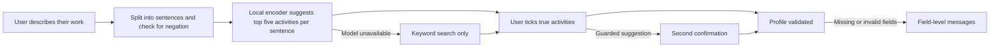

<div align="center">


# AIVANCIN

### From the work you already do to the closest graduate roles, for underemployed Malaysian graduates.

You describe what you actually do, in your own words. An AI suggests the matching work activities, you confirm the ones that are true, and AIVANCIN shows the closest graduate-level roles that use that work, what each still requires, what AI is already doing in those tasks, and a free, verified plan for the gaps.

<sub>Built for SDC Hackathon 2026 · Team DOVUN · Domain One: The Aiversecity Future-Ready Workforce Domain</sub>

**[Live demo](https://aivancin--jadfahmi.replit.app)** · [Pitch deck](submission/AIVANCIN_Pitch_Deck.pdf) · [Run locally](#how-to-run)

</div>

## Team Information

<div align="center">

| Field | Details |
| --- | --- |
| **Team Name** | DOVUN |
| **Team Domain** | Domain 1: The Aiversecity Future-Ready Workforce Domain |
| **SDG Track (1-17)** | SDG 8: Decent Work and Economic Growth (target 8.5) |
| **Team Leader** | Jad Fahmi |
| **University** | German-Malaysian Institute |
| **Number of Members** | 5 |

</div>

## Links

<div align="center">

| Resource | Link |
| --- | --- |
| GitHub Repository | https://github.com/AIVANCIN/aivancin |
| Replit Project | Deployed from the team leader's Replit account; proof in [submission/Replit Proof of Use.pdf](submission/Replit%20Proof%20of%20Use.pdf) |
| Live Demo | https://aivancin--jadfahmi.replit.app |
| RunPod Endpoint | None: RunPod ran one training pod, not an endpoint (see How We Use RunPod) |
| Slide Deck | [submission/AIVANCIN_Pitch_Deck.pdf](submission/AIVANCIN_Pitch_Deck.pdf) |
| Demo Video | Added here when it is published on YouTube |

</div>

---

## Overview

> **The problem:** many Malaysian graduates work in jobs below their qualification, and before spending evenings and savings on retraining they cannot easily see which graduate-level job is closest to what they already do.  
> **Our approach:** read the user's own description of their work, suggest the matching O\*NET work activities with a local AI model, let the user confirm each one, then match roles by activity overlap.  
> **The result today:** a working web app, live on Replit and runnable locally from the same bundled files: free text in, activity suggestions with the sentence that triggered each, a guard against "I have never..." statements and confirmation; then up to three supported career routes as summary cards, each opening to the work, its future (US job projections, Malaysia's observed trend, and how its activities are shifting) and its first block, a chosen route's first learning block that fits your weeks, hours and budget, a Future Skills Radar tab for your skills and routes, and what changes when the AI-usage evidence changes. An exploration view still lists the closest graduate-level roles by activity overlap, each with requirement labels, a US job outlook, dated AI-usage evidence, a Future Skills Radar projecting how each activity shifts under three scenarios, a DOSM pay step, SDG reasons and a plan from link-checked free courses.

| Snapshot | Details |
| --- | --- |
| **Who it's for** | A Malaysian diploma or degree holder aged 25-34 working in a semi- or low-skilled job (for example a van driver, cashier or call-centre agent), before committing to retraining |
| **What works now** | Intake with suggestions, guard and confirmation; route comparison over 17 supported destinations; first learning blocks with practice checkpoints; what-changed comparison between evidence releases; role matching by lane; requirement labels; job outlook with an optional outlook order; AI-usage evidence across four releases with replay; Future Skills Radar tab with four separate signals (US job projections, skill demand, AI shift with time to threshold, Malaysia's observed trend) under slower, moderate and faster scenarios; registered forecasts for the next release to score; plan; SDG tags; a cohort view for career centres on a synthetic cohort; web interface, live at https://aivancin--jadfahmi.replit.app |
| **Demo mode** | Model inference runs live on the CPU from bundled files; data are bundled, dated snapshots; personas are synthetic |
| **Reviewed revision** | Checks below were run on 20 to 22 October 2026 (Windows 11, Python 3.13); each row names its date |

### Problem

In Q2 2026, 40.7% of employed tertiary-educated Malaysians aged 25-34 (751,100 people) worked in semi- or low-skilled jobs ([DOSM `lfs_qtr_sru_age`](https://storage.dosm.gov.my/labour/lfs_qtr_sru_age.csv), CC BY 4.0). Take Hafiz, a synthetic persona: 27, computing diploma, van driver. Searching by his job title points to vehicle-operator roles. His weekends tell a different story: he fixes friends' laptops and wifi, installs software, makes backups and keeps his uncle's shop website updated. That is the work that leads towards graduate roles, and job-title tools never see it.

**What people do today.** A general chatbot can suggest plausible roles and even cite AI-usage figures, but its narrative advice varies between runs and does not show which recorded activities the match rests on. Skills platforms such as MyMahir ask the user to pick a target role first.

**What it does not solve here.** Turning casual descriptions of side work into checkable, confirmed activity evidence, and ranking roles reproducibly from that evidence.

**Challenge alignment.** Domain One asks for skills intake, an AI-trend signal layer, future-role matching, a reskilling pathway, SDG mapping and handling of uncertainty. Each has a first working version here; on fresh synthetic test sets, suggestion accuracy and the advantage over keyword search pass, while the complete chain misses its bar (see Evidence). The SDG link is target 8.5 (productive employment and decent work for young people) through the skill-level step of each role, with a reasoned tag on every plan step: 4.4 (relevant skills) always, 4.3 (affordable learning) when the step is free and 8.2 (productivity through technological upgrading) when it practises directing and checking AI output. A "Decent work (SDG 8.5)" route order and a "How this path contributes" card make the link visible; SDG 5 appears only as national context.

### Solution

The app opens on a welcome screen with the artwork, then asks four short questions one at a time (current job, other work, studies, time and budget). Review, routes, plan and what changed each get their own screen, with a back button and the brand in the top bar; only questions and review pages replace the brand with progress; on screens 1100 px and wider the tabs become a sidebar with the brand and your chosen route, the sections spread into columns, the questions sit beside a panel listing all four, and the review lists every sentence and where it stands beside the current one; the browser's back button follows the same path. Get started opens the tabs (Routes, Radar, Plan, Learn, Profile) straight away: before you describe your work, Routes lists all 17 supported roles with their future, job-ad links and a first block on starting assumptions (6 hours a week, no budget), the Radar shows the main activities of those roles, and a card leads to the questions. After you confirm your activities, the same tabs show your own routes. Each tab returns to where you left it; the questions and the review have no tabs. Only the first question is needed: "Read my work now" skips the rest, keeping their starting values. The review then goes one sentence per page, like the questions, each with its five suggestions and Next; the job title's activities follow, and a last page holds your list, a search for anything missed and Compare routes. The bar counts the questions (1/4 to 4/4) and then the review's pages. Your answers and choices are kept in this browser, so the welcome screen offers to continue your plan. The interface uses KL Pro, a live Jost wordmark and responsive WebP artwork. The welcome wordmark stays white at every aspect ratio. The gear button opens Display & accessibility: Appearance follows the device or your Light/Dark choice; Text size scales all text in five steps from the browser's own size up to 175% (layouts reflow, and the bottom action bars join the end of the page from Extra large); Bold text sets the interface one or two weights heavier; Increase contrast darkens secondary text and separators, outlines cards, makes bars solid and underlines links, and follows the device's contrast preference until you choose; Motion defaults to Device, with Full and Reduced overrides. These choices stay on your device when browser storage is available, and Clear my data leaves them. Long explanations, per-item figures and source notes sit behind short disclosures (for example "Show figures" on a route's Future tab and "What the course expects" on a plan step), so each screen leads with the decision. The settings sheet and the welcome screen also open How it works. `?motion=auto|force|reduce` also sets motion. Hidden tabs pause animations.

Run the motion and display preference checks with `node --test tests/motion.test.cjs tests/display.test.cjs` (Node.js built-in test runner), alongside `pytest`. Artwork was resized with the already available Pillow tool; there is no additional runtime dependency. Original PNGs are retained in `assets/art`, while the page loads WebP derivatives and uses the wordmark artwork only for its social preview.

The AI is a local sentence encoder, all-MiniLM-L6-v2 fine-tuned on O\*NET's own task-to-activity links (quantized ONNX, about 23 MB, run on the CPU with ONNX Runtime). Each sentence the user writes is encoded and every one of the 2,087 O\*NET 31.0 detailed work activities is scored by how close the sentence is to the activity's name (70%) and to the closest of the 17,578 O\*NET task statements linked to it (30%), whose wording is nearer to how people describe their work; the five highest are suggested, each with the sentence that triggered it. The AI only suggests: nothing enters the profile until the user ticks it, and suggestions that come only from a negated or aspirational sentence need a second, deliberate confirmation. The small model does not know most short forms ("I built an IOC enricher" gets construction and grant-writing activities; written out in plain words, it gets security analysis), so a sentence with one asks the user to write it out. It also misreads a few everyday work terms ("bookkeeping" as housekeeping, "keep the books" as library books, "IT support" as safety equipment), so the copy it reads uses O\*NET's words for them; the user still sees their own. A phrase saying who the work is for ("for my aunt's beauty salon") counts for half, because in a long sentence it outweighed the work itself (the salon got reservation activities, not the website). Everything after the confirmed profile is deterministic: roles are ranked by the weighted share of their recorded O\*NET activity links that the user confirmed, and labels, AI-usage figures, pay steps, scenarios and plans are computed from bundled, dated sources with fixed templates. No generative model runs in the product. The encoder was fine-tuned once on a RunPod GPU and replaced the original model only because it passed a gate fixed before training: 45 of 60 held-out casual descriptions with a correct activity in the top five, against 39 for the original (see How We Use RunPod).

### Key Features

- **Activity suggestions from your own words:** "I install software and clean out viruses" suggests "Install computer software" and "Resolve computer software problems", with the sentence highlighted by character offsets.
- **Names, gender and age do not change the reading:** the model reads a neutral copy of each sentence (gendered words, stated ages and personal names made neutral; you still see your own words). On two pair sets written before their runs, 42 work sentences in 198 variants across Malay, Chinese, Indian, Iban, Kadazan and other names, gendered words and ages, and 8 whole profiles, give identical suggestions and routes; before the change only 2 of 22 did. A self-introduction ("Hi, I'm May", "My name is Siti and...") is not read at all, because names such as May, Will or Grace are also words: on a set written before the change, five introductions with 15 names went from 0 of 5 to 5 of 5 identical.
- **Nothing accepted silently:** every activity needs an explicit tick; "I have never repaired a laptop" puts its suggestions under a second confirmation; the server rejects activities the model never suggested.
- **Works when the AI does not:** if the model, tokenizer or vectors are missing or do not match their recorded hashes, the API says AI suggestions are unavailable and keyword search keeps working.
- **Compare routes, then plan:** up to three supported destinations (17 roles: 4 in IT and network support, 4 in software development and testing, and 9 in finance, reporting and data analytics) that your confirmed work already overlaps, each with its requirements (met, missing, planned when you said you would take a longer qualification, or for you to decide; a degree that O\*NET states twice counts once, with both sources), US outlook, first-block hours and cost, and the share of its priority gaps that have a verified resource, without a combined score. The routes are compact cards (role icon and title, activity overlap, the confirmed activities behind the route with exact and related connections counted separately, the entry requirements still open, how many of its eight priority gaps the first block reaches, a "Limited support" label when a route rests on the two-activity minimum or partly on related activities, and the selected order's outlook or pay cue) that you can reorder by overlap, outlook or entry; each opens to its overview, a Future tab (the US projection with BLS's own record of how often its projections were right, Malaysia's observed trend for the role's skill group, and its ten largest activities with skill demand, AI usage, scenario values and time to threshold, plus O\*NET's emerging tasks and in-demand tools), its first block, and a Job ads tab that opens a job-ad search for the role on JobStreet Malaysia or LinkedIn (the app lists no jobs itself). A bookmark keeps a route under Saved routes in Profile, and Routes gains a Saved filter. A suggestion you reject with "None of these fit" leaves your profile unless you ticked it on another sentence. Rejecting a sentence, or reaching Routes with fewer than two routes, offers one optional follow-up: "What do you personally do for this? Describe the records or tools you use and what you produce." The answer joins the same answer box and goes through the same reading, guard and ticks, with earlier answers, ticks and rejections kept; "I keep the books for our shop" gets storage and inventory suggestions, while the follow-up "I enter supplier bills, reconcile the bank statement every month and prepare the profit and loss statement" gets reconciliation, financial documents and account records. Choose one to get an ordered first block (largest gaps first, or, with "Skills with more growth than decline first" on Plan, steps for skills with more of their weight in US roles projected to grow than to decline first; the plan names the steps that option adds or leaves out): curated free courses in prerequisite order, each with the provider's stated objective, a practice checkpoint that produces something you can show, and hours counted once. Among steps that reach the same largest gap, the one serving more of the priority gaps comes first. The plan opens with **Start here**, the next session in full: the exact unit to open (the step's first exercise when it has one, otherwise its first lesson, from the provider's own unit list with its stated minutes and link), what it builds on and what the course expects, the software or account the checkpoint needs (for Hafiz's Web Developers plan, Visual Studio Code and a browser; for Priya's Accountants and Auditors plan, a free spreadsheet, with the Dynamics 365 walkthroughs not needed), its hours against your week, and the output you keep. Marking it done moves Start here to the next step. Below it, "If AI moves faster or slower" counts, for each scenario, the checkpoints that add AI checking and the AI-practice steps that join within your time (and those that would need more), names the figure that decides each change, and says why each other step stays (a later step needs it, or AI stays below the threshold); the courses and their order are the same in every scenario.
- **No dead end:** when fewer than two supported routes count your work, Routes first lists the supported roles your work already touches (each opens to its detail, with how many of your activities count toward the two a route needs, and cannot be chosen until more work is confirmed), then adds up to three of the closest other graduate-level roles, labelled "Exploration: no curated first block yet", each opening to its gaps, outlook and resources; when no graduate-level role records your activities at all, it says so and offers to describe more or to look at every role.
- **Related activities count once a route is anchored, and each role activity counts once:** O\*NET links near-identical activities to different roles ("Design software applications" to Software Developers, "Develop computer or online applications" to Computer Programmers), so a confirmed activity also counts toward a route's two-activity minimum when the role has a near-identical one (same O\*NET group and similar wording) that no other confirmed activity already stands for. A route needs two of the role's activities, each backed by a different confirmed activity: one piece of work confirmed in two wordings counts once (changed 22 Oct; before, it counted twice). The route says which activities counted and which counted once; a role left with one is listed under "Close to your work, not yet a route" with an example of what is still needed. Overlap, order and gaps stay exact.
- **Learn and Profile:** Learn leads with the courses in your first block. Each course expands to its verification date and provider link; alternatives and gaps without a verified course open separately. All verified options remain available, with family colours and a pink edge on courses in your block. Profile shows a seven-step progress checklist, your saved routes with Remove, your answers and confirmed activities with Edit, and Clear my data.
- **What changed, and your choice:** with your work, constraints, target and completed steps fixed, compare the plan under two AI-usage releases; steps are marked added, removed or changed, with the dated figures behind each change a tap away, and the kept steps share one list. Each change also says whether it rests on weak evidence (a single release or a thin sample, on either side of the change) or on measured evidence, and whether it holds in every scenario or only under the slower or faster assumption; kept steps say whether they stay the same in every scenario. A chosen plan records the release it was built on; when a newer one is bundled, Plan and the welcome screen's Continue say how many of your steps it changes, and What changed lets you use the newer evidence or keep your plan as it is.
- **Roles that use your work:** the closest graduate-level roles (O\*NET Job Zone 3 or 4, and skilled in Malaysian terms: MASCO major groups 1-3; semi-skilled and unmapped roles appear only if you choose to explore them) by activity overlap, in a lane you choose (current job, other work, studies or all), with what you already do, what is still to build and labels such as "usually needs a bachelor's degree".
- **AI-usage evidence, kept separate:** the share of Claude conversations on each role's tasks where AI does the work directly, averaged over four Anthropic Economic Index releases with intervals and a release replay. It changes the order only if you set a weight (off by default).
- **Future Skills Radar (a tab):** opens with the activity chart and its scenario/look-ahead controls. Updates keep keyboard focus and open disclosures; a failed update restores the previous settings and offers retry. Jobs, Malaysia and uncertainty details expand on request. Four signals, each sourced and dated and never combined into a score. *Jobs:* your routes grouped by the US projection (BLS 2025-2035), with Malaysia's observed DOSM trend for their skill groups (for example professionals: employees 1,557k to 1,945k and the median wage RM4,400 to RM6,124, 2016-2025; observed, never projected). *Your skills:* a chart of your confirmed activities (pink) and your routes' gaps (blue), across by skill demand (the share of the activity's weight in US roles projected to grow, minus the share in roles projected to decline; the pool is O\*NET Job Zone 3 and 4 roles, which usually need vocational training or a degree, managers excluded; labels read "more growth than decline", "mixed" or "more decline than growth", never "mostly growing") and up by how much of it AI does directly in observed Claude use, with an arrow to the slower or faster scenario's value; the same values are in a table. *Skills that are changing:* the gaps whose checkpoint adds AI checking, each with its time to the threshold. *How sure is this:* the backtest (predicting the June 2026 release from the three before it: the average was off by 16.33 points on average, 80% of errors within 25.96 points) and, kept separate, its calibration test (the 17.9-point band from predicting March 2026 from the two releases before it held 64.8% of the June values, outside the 70-90% a calibrated band needs, so the ranges are labelled rough, not calibrated), BLS's evaluation of its own projections, each scenario's basis and the release means. Scenario and look-ahead are shared with the plan, so a new release or scenario changes the plan.
- **Forecasts that can be checked later:** today's AI-shift outlook for 1,081 activities is frozen in a hashed file (`data/forecast/registered-2026-10-21.json`), with a script that scores it against the next Anthropic Economic Index release.
- **Job outlook, kept separate:** each role shows the US Bureau of Labor Statistics projected growth for 2025-2035 (via O\*NET OnLine) and Bright Outlook flags; routes can be ordered by outlook, and in the exploration view you can switch to an order that adds the outlook to the overlap score.
- **A plan from verified resources only:** steps for the largest gaps from link-checked free Microsoft Learn modules and Saylor University courses, hours and weeks at your pace, and "no verified resource" where none exists. A step that builds on another comes after it (Python testing after Python fundamentals, tax work after tax set-up) and says so; each step opens what the provider expects you to know; Dynamics 365 and Microsoft 365 Copilot modules are marked free to read, with their own exercises needing the paid product while the plan's checkpoint works in a free spreadsheet. Where the verified courses do not teach a route's central work, the plan says so: Budget Analysts points to Saylor BUS105 Units 7 and 8 (budgets and variance analysis, in a 53-hour course that fits only longer plans), and Tax Preparers says no verified free course teaches preparing income tax returns.
- **SDG reasons you can check:** each plan step carries its SDG tags, and its checkpoint says why each applies; routes can be ordered by "Decent work (SDG 8.5)" (the DOSM 2025 median wage of the role's skill group, higher first, then overlap); Plan's "How this path contributes" counts the skill-level step and pay step, the gaps served and hours, the free steps and the checkpoints with AI checking, beside the 25-34 underemployment trend (31.3% in 2017 Q1 to 40.7% in 2026 Q2) and the SDG 5 context; Profile repeats the counts. Target wording is from sdgs.un.org.
- **Every number has a source:** each section's Sources button opens the dated sources behind its figures, without leaving the screen; the settings sheet holds the full list with the licence notes.
- **Sources checked against upstream:** `python tools/check_sources.py` compares each bundled source with its upstream version (Anthropic Economic Index release folders, the O\*NET database version, the DOSM files' latest dates, the BLS projection period on O\*NET OnLine) and records current, newer available or unknown in `data/source_status.json`; the Radar's source dates and the Sources sheet show the last check (21 Oct 2026: 6 of 6 current). It never changes the data: a newer release enters only through the snapshot builder.
- **How it works, in the app:** a sheet from the welcome screen and the settings sheet explains describe, Radar, routes and plan as the app does them, and lists the measured checks below with their results, dates and commands.
- **A cohort view for career centres:** "For career centres" on the welcome screen counts a bundled synthetic cohort of 60 graduates (the written test profiles, no real student): how many have a route and in which family, a heatmap of the priority gaps each family's members share (a count in every cell, shaded by its share of the family), the learning steps many first blocks share (Saylor's PRDV201 Information Literacy is in 23), and what the first blocks add up to against SDG 8.5, 4.4, 4.3 and 8.2. Counts only, never a score; it takes no input and changes no one's routes.
- **Reproducible data:** every dataset and the model are bundled with their source, release date, licence and SHA-256 hashes; the same input always gives the same suggestions and ranking.

## See it in action

Open the live prototype at **https://aivancin--jadfahmi.replit.app** (no account or key needed), or run the same build locally ([start it first](#how-to-run)) at `http://127.0.0.1:8000/`. The pitch video follows this walkthrough; its deck is [submission/AIVANCIN_Pitch_Deck.pdf](submission/AIVANCIN_Pitch_Deck.pdf).

1. **Start:** on the welcome screen press "Try an example" (Hafiz, a synthetic persona: computing diploma, van driver; Priya is one tap away), then Continue through the four questions and "Read my work". "Get started" opens the 17 supported roles to explore first, with "Describe your work" leading to the same questions empty.
2. **Watch:** each of his 9 sentences appears with its five suggested activities, all unticked; "On weekends I fix my friends' laptops and set up their home wifi" includes "Resolve computer network problems".
3. **Decide:** tick what is true: "Resolve computer network problems", "Install computer software", "Create electronic data backup to prevent loss of information" and "Update website content" from his weekend work, and "Write computer programming code" from his studies; then press "Compare routes".
4. **Compare and choose:** three routes appear (Computer Network Support Specialists, Web Developers, Computer Programmers), as cards with the work behind each, the requirements still open and the priority gaps the first block reaches, plus the shared foundations. Open Web Developers for its work, future and first block, then choose it to see the ordered block (14.3 of 32 hours, RM0). It opens with Start here: "Get started with web development using Visual Studio Code", whose four exercises start with "Set up the structure of your web app" (5 minutes); it needs Visual Studio Code and a browser, takes 1.2 hours, and leaves a web page with a script he checked in the browser's developer tools. "If AI moves faster or slower" shows that 5 of his 7 checkpoints add AI checking in every scenario and the specification step only in the faster one, while Python fundamentals stays before the pytest steps in every scenario.
5. **What changed:** compare the plan under the August 2025 and May 2026 evidence: for this plan nothing changes, and the screen says so. "Or explore all roles" shows the full ranked list, where all six closest roles change against his job title alone.
6. **A plan that moves with the scenario:** Priya (one tap away; tick the first two suggestions on each sentence) chooses Accountants and Auditors (6 hours a week). Her Start here is "Describe the general ledger in Dynamics 365 Finance", read in a free spreadsheet without Dynamics 365. In "If AI moves faster or slower", 0, 3 and 5 of her 6 checkpoints add AI checking in the slower, moderate and faster scenarios, and two short AI-practice steps ("Work smarter with Copilot prompts for finance professionals", "Summarize sales data using Copilot in Excel") join only in the moderate and faster ones, each with the figure that decides it; the general ledger module stays before the daily-procedures module in every scenario.

**Replay an evidence update:** `python tools/checks/replay.py` keeps Hafiz, his limits (5 hours a week for 4 weeks, RM0, no new degree), his target (Network and Computer Systems Administrators) and a completed step fixed, and swaps only the AI-usage evidence from the January 2026 to the March 2026 release. One step, "Fundamentals of computer networking", gains AI checking, because "Provide technical support for computer network issues" moves from 38.1% to 50.4% (threshold 50%); the other six steps, the hours and the cost stay. The command prints both plans and runs 12 checks, including a separate recomputation of every figure and checkpoint from the raw files and an unrelated evidence change that must leave the plan alone. It is a demonstration of traceability, not of a trend: the January value rests on one task statement and 26 conversations, which the "What changed" view shows.

**Try the same scenario through the API:** `http://127.0.0.1:8000/docs` lists `POST /api/suggest`, `/api/profile`, `/api/results`, `/api/routes` and `/api/update`.

**When something goes wrong:** send `{"weekly_hours": 0}` to `/api/profile` and the response lists a message for each invalid field; remove `data/model/model.onnx` and `/api/status` reports AI suggestions as unavailable while search still works.

## How it works



| Stage | What the user does | What the product actually does |
| --- | --- | --- |
| **1 · Begin** | Answers four short questions (current job, other work, studies, time and budget), or loads a persona | Splits the text into sentences with offsets; flags negated or aspirational sentences |
| **2 · Process** | Waits (tens of milliseconds) | Encodes each sentence and scores all 2,087 activities by their names and linked task statements |
| **3 · Review** | Ticks the true activities, searches for missing ones, unticks job title activities | Shows each activity once with every sentence that triggered it |
| **4 · Complete** | Moves on to compare routes or explore all roles | Recomputes the suggestions server-side, enforces the guard and returns the confirmed profile |

### What makes this approach different

| For this task | Keyword search | AIVANCIN |
| --- | --- | --- |
| **Casual wording** | Needs the catalogue's own words | Matches by meaning: "back up their phones and laptops to external drives" suggests "Create electronic data backup to prevent loss of information" |
| **Wrong suggestions** | Accepted or ignored without trace | Every activity is confirmed by the user, with the triggering sentence shown |

**Trade-off:** the user has to review suggestions, and the model and vectors add about 26 MB to the repository.

## What is implemented

| Capability | Current status | How to verify |
| --- | --- | --- |
| Activity suggestions from free text | WORKING (API) | `tests/test_intake.py`, `POST /api/suggest` |
| Guard, confirmation and validation | WORKING (API) | `tests/test_intake.py`, `POST /api/profile` |
| AI-unavailable fallback | WORKING (API) | `tests/test_app_and_failures.py` |
| O\*NET 31.0 and model snapshots | CACHED (bundled, hashed) | `data/manifest.json`, `python tools/build_snapshots.py` |
| Role matching with lanes, requirement labels | WORKING | `tests/test_matching_and_report.py`, `POST /api/results` |
| AI-usage evidence, replay, scenarios, plan | WORKING (first version) | `tests/test_matching_and_report.py` |
| SDG reasons, path contribution, Decent work order | WORKING | `tests/test_sdg.py` (C8, C9) |
| Step order option, "Skills with more growth than decline first" | WORKING | `tests/test_routes.py` (C7: B3 and B4 under both orders, a worked example, the named differences) |
| Keep or accept new evidence | WORKING | `tests/test_keep_accept.py` (C10), `POST /api/update` |
| No-dead-end exploration cards | WORKING for 5 of 6 out-of-scope test profiles (see Evidence) | `tests/test_no_dead_end.py` (C15) |
| Cohort view for career centres (synthetic cohort) | WORKING | `tests/test_cohort.py` (K1-K3), `GET /api/cohort`, `python tools/build_cohort.py` |
| Fairness: names, gender and age | WORKING | `python tools/checks/c13_fairness.py [result.json] [pairs.json]`, `tests/test_fairness.py` (C13) |
| Encoder fine-tuning on RunPod | DONE AND SHIPPED: one run on an RTX 4090 pod, passed its gate fixed before training | `tools/finetune/` (see its README), `data/model/finetune.json`, `tests/test_finetune_prep.py`, `tests/test_finetune_ship.py` |
| Routes, first learning blocks, shared foundations, what changed | WORKING (first version) | `tests/test_routes.py` (B1-B6), `/api/routes`, `/api/update` |
| Evidence-to-plan replay | WORKING | `python tools/checks/replay.py`, `tests/test_replay.py` |
| Source watch | WORKING (run by hand; the app never fetches) | `python tools/check_sources.py`, `tests/test_source_watch.py` (C14, recorded responses) |
| How it works sheet with the measured checks | WORKING | `data/checks.json`, `GET /api/status`, `tests/test_app_and_failures.py` |
| Future Skills Radar and job outlook | WORKING (first version) | `tests/test_matching_and_report.py`, `tests/test_forecast.py`, `python tools/checks/a18_backtest.py` |
| Skill demand, time to threshold, Malaysian trend, registered forecasts | WORKING | `python tools/checks/forecast_checks.py` (C1-C5), `python tools/export_forecasts.py` |
| Web interface | WORKING (local and live on Replit) | `tests/test_app_and_failures.py`; scripted Edge runs at 390 and 1280 px in light and dark, 21 and 22 Oct 2026; the Replit deployment serves byte-identical `app.js` and `app.css`, 22 Oct 2026 |
| Acceptance checks A1-A3 on fresh test sets | RUN: A1 and A3 pass, A2 fails | `python tools/checks/a1_a3.py`; see Evidence |
| Acceptance checks A4, A6, A7 | RUN: A4 and A7 pass, A6 fails | `tools/checks/`; see Evidence |

**Boundary:** AIVANCIN does not judge proficiency from text, make its own employment forecasts or say whether a role is reachable. Job projections are BLS's; Malaysian figures are observed. The server reads only what the user writes and keeps nothing; answers and choices stay in the user's browser until they clear them.

## Evidence and limitations

The app behaves as specified on the bundled data and synthetic personas; whether it helps real users has not been tested.

| What we checked | Observation | Reproduction and limits |
| --- | --- | --- |
| **Core path and recovery** | PASS, 312/312 tests | `python -m pytest`, 22 Oct 2026, Windows 11, Python 3.13; network access blocked during tests; includes missing, altered and mismatched model files, a corrupted AI-usage release and expired course link checks |
| **Forecast signals (C1-C5)** | PASS, 4 of 4 gated checks, plus one reported. Skill demand for 1,721 activities reproduces from the raw files with a separate implementation (0 mismatches); time to threshold matches the formula on 1,464 Radar values for Hafiz and Priya; the Malaysian trend reproduces for all 9 groups and pay steps still use 2025; the registered forecasts reproduce byte for byte. Reported: 103 and 176 of 1,721 demand labels change with cut-offs of 15 and 35 points instead of 25 | `python tools/checks/forecast_checks.py`, 21 Oct 2026. Skill demand inherits BLS's uncertainty; the registered forecasts have not been scored, because no later AI-usage release exists yet |
| **Every number has a source (C6, C16)** | PASS. All 30,810 figures in the Radar and Future data for Hafiz, Priya and the explore view, under four settings, cite a dated source, and 1,400 rows of AI-shift classes and skill-demand labels agree with their projections and cut-offs. In Edge at 390 and 1280 px, light and dark, the whole flow (explore, Radar, the four questions, review, routes, Future, first block, plan with its SDG card, Learn, Profile, What changed keep and accept, Sources and How it works) shows no number without a source on 22 screens per run, no horizontal scroll and no console error, and a keyboard walk reaches each screen's controls with a visible focus ring | `python -m pytest tests/test_forecast.py -k c6`, 21 Oct 2026; the browser run is a scripted Edge session (Playwright). Its first run found counts and sentences without a source on ten screens (for example the review's activity counts and the route overview's Malaysian trend), fixed in 8c7b0b0. Dates, codes and the person's own entries are not counted as figures |
| **Skill-outlook backtest** | Predicting the June 2026 value of 500 activities from the three earlier releases: historical average 16.3 points mean absolute error, last value 17.8, trend line 22.0. Past changes continued in only 31.9% of 364 cases | `python tools/checks/a18_backtest.py`; protocol and thresholds fixed before the run; one release only, across a format change. Hence the moderate scenario uses the average and the radar shows no rising or falling labels |
| **Cohort view (K1-K4)** | PASS. A separate recomputation from each member's routes reproduces the summary (60 members, 50 with a route), every heatmap cell and shade, the by-route counts, the shared steps and the SDG totals (48 of 50 first routes lead to skilled work; 173 gaps served; 220 of 220 steps free; 129 AI-checking checkpoints); every figure cites a dated source; the endpoint takes no input and a person's routes are identical before and after it runs. In Edge at 390 and 1280 px, light and dark: reached by keyboard from the welcome screen, a count in every cell with the specified shade, no horizontal scroll, no console error, no number without a source | `python -m pytest tests/test_cohort.py`, 21 Oct 2026; the browser run is a scripted Edge session. A shifted shade cut and a wrong first route each make K1 fail. The cohort is synthetic, so it shows the mechanism, not a real cohort's needs |
| **Hafiz contrast** | Job title alone: 0 of the top 10 roles are computing roles; with his confirmed weekend work: at least 6 of 10 | `tests/test_matching_and_report.py`; relevance rule fixed before the earlier research probe; synthetic persona |
| **Suggestion accuracy (A1)** | PASS. Second set, written and committed before the scoring change: 19 of 20 everyday descriptions have a correct activity in the top five with the old scoring, the new scoring and the fine-tuned encoder (bar: 16), 20 of 20 since the 22 Oct reading without who the work is for. First set: 20 of 20 with the fine-tuned encoder, 18 before it (16 before the scoring change; it was used to develop it) | `python tools/checks/a1_a3.py [result.json] [sets.json]`; sets in `tests/acceptance/`, written and hashed before their first run; synthetic, agent-written English |
| **Everyday work terms** | PASS, 16 of 18 sentences that use "bookkeeping", "the books", "IT" or "cybersecurity" get a correct activity in the top five, against 7 before; 10 of 11 controls with the same words in other senses keep identical suggestions. The eleventh, a bookshop's "books and magazines section", now gets financial records offered (nothing is accepted without a tick). Measured on the work-term change alone; the later change for who the work is for keeps 16 of 18 and alters two controls ("for an online bookshop", "for our family trip") as that change intends | `python tools/checks/work_terms.py result.json [baseline.json]`, 22 Oct 2026; set written and committed before the change; builder-written English, used once. Still missed: "I help with IT support at my cousin's travel agency" and "basic IT work ... setting up new laptops". A1-A3, guard, fairness, ownership and held-out results identical; B7 set 3 from 7 to 8 of 12; the S2-K7 chain from 32 to 33 of 50 |
| **Who the work is for** | PASS, a modest gain without losses in any count: held-out casual descriptions 47 of 60 with a correct activity in the top five (45 before), A1 sets 20 and 20 of 20 (20 and 19), true activities reached on B7 sets 1-5 209 (204) and on fresh set 7 37 (35); route passes, A2, A3, guard, fairness and ownership unchanged | Chosen on the development sets among five variants (splitting sentences into clauses made every count worse); then run once on set 7. Individual sentences can lose: "I write the payroll program for a small furniture factory" loses "Write computer programming code" from its five, and "sign for their parcels" is read as a beneficiary |
| **Complete chain (A2)** | FAIL, 32 of 50 top-five roles relevant (bar: 30, met; 29 before the scoring change, and these profiles guided it) but 5 of 10 profiles with three or more (bar: 7), other-work lane; the same with the fine-tuned encoder | Strong for electrical, motorcycle repair, laboratory, tutoring and finance work; weak for marketing, civil works, HR, statistics and agriculture. Information only: the studies lane on the same activities gave 31 of 50 and 7 of 10, partly because relevance follows the degree field |
| **Improvement against a baseline (A3)** | PASS, the model chain beats keyword (BM25) suggestions on the same text by 16 relevant roles per 50 (32 against 16; bar: 10) | Same run and sets as A2 |
| **Regression (A4)** | PASS: the earlier probes' 35 of 50 (all true activities) and 31 of 50 (the full chain) reproduce after the scoring change; profiles with three or more relevant roles fall from 7 to 6 of 10 in the probes' pool, while the chain rises from 28 to 30 of 50 in the product's skilled pool | The first run gave 29 of 50 for the chain; the cause was that the quantized model made a text's vector depend on the other texts in its batch, so every text is now encoded on its own |
| **Guard (A6, C12)** | First set PASS, 18 of 18 sentences fully guarded (15 before the free-time, failed-attempt and dated-plan cues of 21 Oct, 12 before the earlier cues). Second set unchanged: 14 of 14 held back, 12 of 12 own-work controls one tick away. Third set, written and committed before those cues: 13 of 14 held back (0 before), 13 of 13 controls. Newest set, written and committed after the cues and before its first run: FAIL, 8 of 14 held back (1 before), 13 of 13 controls; across 555 own-work sentences in the other test files, none newly flagged | The third set guided the cues, and the newest set's first run (10 of 13 controls) led to dropping a bare "I will" or "I'll" as a plan cue, because Malaysian English often uses it for habits; so only the newest set's 8 of 14 is a first-run result. Still not caught: other pastimes ("I collect stamps", "I like to swim"), plans with a date but no cue ("In January I start a course"), and rejections or failures in other words. Every suggestion still needs the user's tick |
| **Evidence-to-plan replay (B6)** | PASS, 12 of 12 checks; the expected change (one step gains AI checking) matches both the app and a separate recomputation from the raw files | `python tools/checks/replay.py`; the only checkpoint changes among bundled releases for Hafiz's IT routes in the default scenario cross the June 2026 format change or rest on the thin January 2026 sample, so this shows the mechanism, not a market shift |
| **Phase 2 target (B7)** | FAIL, though the fine-tuned encoder (21 Oct) raised every set: 9, 10, 7 and 8 of 12 in-scope profiles on sets 1 to 4, from 8, 8, 4 and 7 (target 10). On 22 Oct the work-term change raised set 3 to 8 (a bookkeeper's "I do the bookkeeping" now reads as financial records), and two catalogue corrections raised set 4 to 10 and set 5 to 2: bank reconciliation also teaches "Verify accuracy of financial information" and Information Literacy also serves "Update professional knowledge", the near-identical twins of activities they already served, so Tax Preparers and Budget Analysts blocks reach three priority gaps more often. Sets 1-5: 39 of 52, from 35; they guided these changes. Counting each role activity once (22 Oct, later) lowers set 3 to 7 and sets 1-5 to 38 of 52: one person's Information Security route rested on one activity counted twice. Five finance profiles lose a Budget Analysts route that rested the same way and still pass on other routes; sets 6 and 7 are unchanged (9 and 8 of 12), and one out-of-scope person in set 6 loses a single Credit Analysts route. Fresh set 6, written and committed before either was run on it: 9 of 12 (8 on the code before the changes; the bookkeeper f01 gains her finance routes), all 4 out-of-scope people without two routes. Its three failures are reading long sentences: "I am building an Android app for my friend's laundry shop..." and "I configured the network so the cameras record..." get the laundry and camera activities, not the app and network ones. Fresh set 7, written and committed before the change that reads each sentence also without who the work is for: 8 of 12 before and after; 37 true activities reached through strict confirmation against 35 (one accounts preparer gains two and a third finance route), no out-of-scope person with two routes. Set 2 reaches the target, but sets 1 and 2 guided earlier changes, so no independent set does. Before the encoder: fourth fresh set (21 Oct, written and committed before the coverage change): 8 of 12 in-scope profiles before and after adding five finance and data roles, 7 after the fairness change (target 10); the two finance and data profiles that fail get only 2 and 3 of their 8 true activities suggested, so the miss is in reading casual text, not in the routes. Reruns: first set 8 of 12 before and after, second 9 to 8 (Tax Preparers, whose block serves 2 gaps, took a slot from Credit Analysts), third 4 to 5, then 4 after the fairness change: reading more of a bookkeeper's true activities ranks Tax Preparers above routes with stronger blocks. Third fresh set, written and committed before the scoring and route-rule changes: 4 of 12 in-scope profiles receive two relevant routes, each with sourced requirements and a four-week block serving three priority gaps (target: 80%); the code before the changes managed 3 of 12. A first version of the related-activity rule reached 6 of 12 on this set, but only through loose links such as a driver's "Read maps to determine routes" counting toward User Support, so the rule was narrowed to near-identical activities after seeing that. Earlier sets: 5 and 4 of 12 when fresh (0 and 1 of 12 before routes); they guided the changes, so their reruns (8 and 9 of 12) are not independent | `python tools/checks/b7_target.py routes [result.json] [profiles.json]`; synthetic, agent-written English; no out-of-scope profile qualifies, though since the coverage change one in the second set sees a Loan Officers route through its current job's activities. Remaining causes on the third set: four profiles get no route (three confirm two or fewer activities, such as CCTV and network cabling or account and equipment admin) and all four finance profiles reach only one finance route |
| **Fine-tuned encoder (A17)** | SHIPPED. Gate fixed before training: 45 of 60 held-out casual descriptions with a correct activity in the top five, against 39 for the original model and 40 for the base model put through the same export (a control, so an export effect cannot pass as a training gain); the earlier complete-chain regression (S2-K7) 32 of 50, not lower than 31. Information only: A1 sets 20 and 19 of 20 (18 and 19 before); 61.4% of O\*NET validation statements with a linked activity in the top five, 51.5% for the base model | `python tools/finetune/evaluate.py`, 21 Oct 2026, on the CPU with the app's scoring; one run, settings fixed before it and not tuned on the held-out set. Seven held-out sentences gained, one lost. Pod, GPU, runtime, cost and data and model hashes: `data/model/finetune.json`. Synthetic, agent-written English |
| **No dead end (C15)** | FAIL, 5 of 6 out-of-scope test profiles see roles to explore instead of routes. With the fine-tuned encoder a home baker (set 4) also gets one more of her true activities suggested, which gives her the two counted activities a route needs for two finance routes (Business Intelligence Analysts, which she already saw, and Financial and Investment Analysts), so she sees no cards | `python -m pytest tests/test_no_dead_end.py`, which records this failure; in Edge, 8 of 10 runs pass and both of hers fail. The cause is the route rule's two-activity minimum; counting each role activity once (22 Oct) leaves hers, because her two finance routes rest on two different activities. Measured 21 Oct and not adopted: every stricter rule that removes her routes also removes in-scope people's routes (in-scope passes across sets 1-5 fall from 35 of 52 to 32 when a counted activity must be in the role's larger 60% by weight, 29 for its larger half, 25 for three activities). A fresh set 5, written before that measurement, has 8 out-of-scope people who also buy stock, take payments or keep sales records: none gets two routes under the current rule |
| **Requirement labels (A7)** | PASS, 20 of 20 roles agree with the raw O\*NET Job Zone and experience files | `python tools/checks/a7_labels.py`; sample rule fixed in the script before the run |
| **Usability with target users** | NOT RUN | Personas and test sentences are synthetic |
| **Speed** | About 51 ms for Hafiz's 9 sentences, model already loaded | Five runs on a laptop CPU; Replit not measured |

**What we can conclude:** suggestions, guard, confirmation, matching, evidence, plan and fallback work as designed on the bundled data and synthetic text.  
**What we cannot conclude yet:** suggestion accuracy or matching quality on real users' descriptions (on synthetic profiles the complete chain missed its bar, A2), or any benefit to users. A role's overlap is overlap in recorded O\*NET activity links, not how much of the job someone can do.

**Known limitations:**

- **English only:** Malay text is not supported.
- **Idioms can miss:** "I keep the books" does not surface a bookkeeping activity in the top five; the "Find another activity" search, which ranks by meaning, lists "Maintain financial or account records" for that wording, so the user can add it there.
- **Guard is a word list:** it works per sentence, so "I don't just drive, I also fix laptops" is flagged and needs the second confirmation; a sentence reads as someone else's work when no first-person subject does anything in it: "My friend repairs laptops for me", "I watch him install software", "I get my car serviced" and "I pay someone to file my taxes" are held back, while "I repair laptops for my friends", "I install software while he checks the settings" and "My manager lets me run the stock count" count; "My brother helps me with the accounts" asks who did the work. On 16 similar-wording pairs written before the change, 32 of 32 sentences are read correctly (19 of 32 before), and none of 551 own-work sentences in the other test sets is newly held back. Free time is recognised only for listed sports, games, shows and books after play, watch, read or go ("I play futsal", not "I collect stamps"); "I will" alone is not read as a plan.
- **US occupation data:** roles, activities and requirement labels come from O\*NET (United States); Malaysian pay steps use DOSM major-group medians mapped through the ESCO crosswalk, and 81 of 940 occupations stay "skill level unmapped".
- **Courses:** the catalogue holds 90 free entries (70 Microsoft Learn modules and paths, 14 Saylor University courses and 6 units of Saylor's Principles of Finance, each with the unit's stated time), so some gaps still show "no verified resource"; whole Saylor courses run 5 to 63 hours, so the long ones fit only longer plans, and enrolling needs a free Saylor account. A block's effort adds a stated practice estimate to the provider's hours. An AI-practice step names the activity it teaches; where none does, the plan offers a general guide to directing and checking AI output and says so.
- **Malaysian requirements and opportunity evidence are not shown yet:** route requirements come from O\*NET (US) and are labelled so; MyCOL and the MyMahir impact study stay out until their reuse permission is confirmed, and the accountancy body's pages could not be checked automatically.
- **Finance routes still lean on product-specific modules for four-week blocks:** many short free finance modules found are about Microsoft Dynamics 365 Finance; units of Saylor's Principles of Finance (2 to 11 hours) now cover financial analysis, the time value of money, valuation, risk, capital budgeting and cash management, but tax preparation, client interviews and financial planning still have no verified free resource, and Financial Risk Specialists stay out because only 2 of their 10 largest activities have one.
- **Projections are estimates:** the moderate projection's error is large (80% of errors within 26 points), the faster and slower scenarios are assumptions, and job outlooks are US projections; Malaysia is shown only as an observed trend for whole skill groups (DOSM), never projected, and no Malaysian per-occupation projection was found to show.
- **Weak routes outside the supported fields:** a route needs only two of the role's activities, each backed by a different confirmed activity, so someone outside IT and finance can still see a weak one (one of the six out-of-scope test profiles sees two).
- **AI-usage figures describe Claude usage worldwide,** not Malaysian labour demand; older releases match about 83% of their tasks to O\*NET 31.0 by text, and unmatched tasks are left out, not guessed.

### Tech Stack

| Layer | Technology | Responsibility |
| --- | --- | --- |
| Frontend | HTML, CSS and JavaScript without a build step, served by the app | Intake, review, results; light and dark appearance |
| Backend | Python 3.13, FastAPI 0.150, Uvicorn 0.54 | Intake, matching, evidence and plan API |
| Database | None; bundled CSV, JSON and NumPy files | O\*NET, AEI, DOSM, crosswalk and catalogue extracts, activity vectors, manifest |
| AI / Compute | all-MiniLM-L6-v2, fine-tuned once on a RunPod GPU (RTX 4090), run as quantized ONNX on the CPU with ONNX Runtime 1.31 and Tokenizers 0.23 | Sentence encoding for activity suggestions |
| Hosting / Dev | Replit Deployments (Cloud Run target, Python 3.12 module) | Live prototype at https://aivancin--jadfahmi.replit.app |

### Privacy, safety and reliability

- **Data:** text is processed in memory for the request and not stored or logged by the server. Your answers, confirmed activities, chosen route, ticked steps and saved routes are kept in your browser's local storage so you can continue later; Clear my data in Profile removes them. There are no accounts. Demo personas and the cohort view's members are synthetic; the cohort view accepts no upload.
- **Sharing:** none. The app makes no network requests; the model runs locally. The source watch (`tools/check_sources.py`) reads public release pages only when someone runs it. Course and job-search links open the other site only when the user clicks them.
- **Security:** inputs are validated server-side, and the server recomputes suggestions rather than trusting the client. No secrets are needed or stored.
- **Failure behaviour:** a missing or altered model, tokenizer or vector file switches to keyword search with a clear message; an altered dataset file stops the app at start-up rather than serving wrong data.

---

## Project Structure

```
.
├── assets/icon/            # App icon
├── assets/fonts/           # KL Pro (separate licence) and Jost (OFL 1.1) web fonts
├── data/                   # Bundled snapshots: manifest.json, onet/, aei/, dosm/, crosswalk/, catalogue/, forecast/, model/, vectors/, personas.json
├── src/
│   ├── main.py             # Application entry point
│   └── aivancin/           # snapshots, encoder, intake, matching, aei, report, pathway, routes, cohort, app; static/ holds the web interface
├── submission/             # Proposal, Technical & Tools Declaration, Replit and RunPod proof, pitch deck
├── tests/                  # Offline tests
├── tools/
│   ├── build_snapshots.py  # Rebuilds data/ from the original sources
│   ├── build_catalogue.py  # Rebuilds the course catalogue, link checks, provider objectives and unit lists
│   ├── build_routes.py     # Builds the supported destinations and applies the admission rule
│   ├── build_cohort.py     # Builds the synthetic cohort for the cohort view from the B7 test profiles
│   ├── destinations_curation.json  # Supported destinations and candidates; build_routes.py applies the admission rule
│   ├── fetch_outlook.py    # Caches O*NET OnLine job-outlook pages for the snapshot
│   ├── export_forecasts.py # Freezes the skill-outlook forecasts for scoring against the next release
│   ├── check_sources.py    # Source watch: each bundled source against its upstream version
│   ├── finetune/           # RunPod encoder fine-tuning: pairs, training script, local gate
│   ├── checks/a18_backtest.py  # Skill-outlook backtest behind the displayed error; --prospective scores registered forecasts
│   ├── checks/forecast_checks.py  # C1-C5: forecast signals recomputed separately
│   ├── checks/replay.py    # Evidence-to-plan replay: one update, 12 checks
│   └── catalogue_curation.json  # Curated course-to-activity links, checkpoints and what each checkpoint needs
├── .env.example            # Optional HOST and PORT
├── .gitignore
├── .replit                 # Replit run configuration
├── LICENSE
├── pyproject.toml          # Test configuration
├── requirements.txt        # Runtime dependencies
├── requirements-dev.txt    # Runtime plus test dependencies
└── README.md
```

### Architecture

```
Browser ──► FastAPI app (src/main.py) ──► intake: sentence split, guard, validation
                  │                            └──► local encoder (ONNX, CPU) + bundled activity vectors
                  ├──► matching: activity overlap by lane over O*NET Job Zone 3-4 roles
                  ├──► routes: supported destinations, first learning blocks, shared foundations, what changed, the Radar
                  ├──► outlook: skill demand (BLS via task links), AI shift and time to threshold, Malaysian group trend (observed)
                  ├──► report: labels, job outlook, AEI evidence and replay, skill outlook, DOSM pay step, SDG, scenarios, plan
                  └──► page and JSON, every number tagged with its source
```

Running the encoder locally on precomputed vectors keeps the demo offline, free and reproducible: there is no API key, no per-request cost and no external service to fail.

---

## How to Run

### Option 1: Run on Replit (Recommended)

1. Open the live deployment at https://aivancin--jadfahmi.replit.app, or import this repository via **Create Repl → Import from GitHub**.
2. No secrets are needed.
3. Click **Run**. Replit uses `.replit` to start `python src/main.py` on its Python 3.12 module.

Verified 22 October 2026: the published deployment answers `/api/status` with AI suggestions available and the four bundled releases, and serves `app.js` and `app.css` byte-identical to this branch.

### Option 2: Run Locally

**Prerequisites:** Python 3.13 (the Replit deployment runs 3.12; other versions untested). No accounts, keys or paid services.  
**Verified on:** a fresh clone, Windows 11, Python 3.13, 22 October 2026 (install, start, `/api/status` and `/api/suggest`).

```bash
git clone https://github.com/AIVANCIN/aivancin.git
cd aivancin
python -m venv venv
source venv/bin/activate        # Windows: venv\Scripts\activate
pip install -r requirements.txt
python src/main.py
```

Open **http://127.0.0.1:8000/** for the app, or **http://127.0.0.1:8000/docs** for the API.

### Run Tests

```bash
pip install -r requirements-dev.txt
python -m pytest
```

**Expected result:** `312 passed`. Tests run offline; outbound network access is blocked.  
**Rebuild the data (optional):** `python tools/build_snapshots.py` downloads the original files into `.cache/` and rebuilds `data/`; pinned files (model, AEI releases) are checked against their hashes, while live sources such as DOSM and the ESCO API can change. `python tools/build_catalogue.py` refreshes the course list and its link checks.

---

## How We Use Replit *(Required)*

Replit hosts the live prototype judges use: **https://aivancin--jadfahmi.replit.app**, published from the team leader's Replit account.

- **How it was set up:** the repository was imported into Replit, and Replit Agent configured the run settings (`.replit`: the Python 3.12 module, port 8000 served on 80, a Cloud Run deployment target running `python src/main.py`) and published the app; its commits ("Configure Replit environment settings", "Published your App") are in this repository's history.
- **What runs there:** the same code and bundled data as this branch, including the fine-tuned encoder on the CPU. The app needs no secrets, database or external service, and it makes no outbound calls.
- **Proof:** [submission/Replit Proof of Use.pdf](submission/Replit%20Proof%20of%20Use.pdf), also Appendix C of the Technical & Tools Declaration.

## How We Use RunPod *(Required)*

One GPU training job, no endpoint: the app never calls RunPod, and the fine-tuned model is bundled and runs on the CPU.

- **What ran:** on 21 Oct 2026 we fine-tuned the sentence encoder on an on-demand pod from the team's RunPod credit: pod `82gxhhkg2yedbz`, NVIDIA GeForce RTX 4090, Secure Cloud, image `runpod/pytorch:2.8.0-py3.11-cuda12.8.1-cudnn-devel-ubuntu22.04`. `tools/finetune/train.py` trained on 21,397 pairs built from O\*NET's 24,087 task-to-activity links (one epoch, contrastive loss, settings fixed before the run) in 15.6 seconds, 25.5 seconds with both model exports. The pod ran for about 28 minutes including setup and download and cost US$0.42.
- **How it was judged:** locally on the CPU with the app's own scoring, against a gate written before training: 45 of 60 held-out casual descriptions with a correct activity in the top five, against 39 for the original model and 40 for the base model put through the same export; the earlier complete-chain regression not lower (32 of 50 against 31). The held-out sentences never went to the pod.
- **Proof:** [submission/RunPod Proof of Use.pdf](submission/RunPod%20Proof%20of%20Use.pdf) (pod ID, GPU type, runtime and cost from the team's RunPod dashboard), also Appendix B of the Technical & Tools Declaration.
- **What changed:** the tuned model replaced `data/model/model.onnx`; the activity and task-statement vectors and the route sibling tables were recomputed for it. The record (pod, GPU, runtime, cost, training data and model hashes, gate results) is `data/model/finetune.json`, with `tools/finetune/run_20261021T1047Z.json` and `tools/finetune/gate_20261021T1047Z.json`; the snapshot builder refuses model files that do not match it.

---

## Challenges & Learnings

- **Unreliable downloads:** the O\*NET server sometimes cut large files short, so the snapshot builder checks the length and falls back to byte-range downloads.
- **Hashes and line endings:** Git on Windows rewrote line endings in hashed data files; `.gitattributes` now keeps `data/` byte-exact so the hash checks hold on every checkout.
- **Testing the fallback:** a test for a missing model file showed the app crashed instead of falling back; the loader now reports "AI suggestions unavailable" and the test guards it.

## Future Improvements

- [ ] Memory, start-up and latency measurements on the Replit deployment.
- [ ] A second fine-tuning round with casual paraphrases, judged on a new held-out set written before it.
- [ ] Malaysian entry requirements and MyCOL or MyMahir evidence, once their reuse permission is confirmed.
- [ ] Malay descriptions, after their own checked test set passes.
- [ ] Testing with real underemployed graduates.

## Team

| Name | Role | Responsibility | GitHub |
| --- | --- | --- | --- |
| Jad Fahmi | Team Lead & Developer | Coordinates delivery and leads implementation | [@jad-fahmi](https://github.com/jad-fahmi) |
| Aqil Amin | Quality Assurance Tester | Tests user flows, reproduces defects and reports findings | [@fakebat2-da](https://github.com/fakebat2-da) |
| Khairin Darwisy | Quality Assurance Tester | Tests user flows, reproduces defects and reports findings | [@KhaiWisy](https://github.com/KhaiWisy) |
| Adam Hasif | Documentation Website Developer | Builds and maintains the project's documentation website | [@Lukecyan1](https://github.com/Lukecyan1) |
| Ammar Hakeem | Documentation Website Developer | Builds and maintains the project's documentation website | GitHub account pending |

## Credits, dependencies and AI disclosure

The product code, tests and synthetic personas were written during the event. The app icon was designed by Jad Fahmi; the welcome artwork was generated with ChatGPT image generation (OpenAI GPT image). Development used AI assistants: Claude Code (Claude Opus 5.5 and Sonnet 5.5) for most code, tests, documentation, the submission documents and the demo video assembly; Codex (OpenAI GPT-6 family) for project-selection research, early interface work and first drafts of the proposal and deck; Antigravity (Google Gemini) for documentation-website work and a design review; and Replit Agent for the Replit run settings and publishing. The team directs the work and reviews the output; every change passes the offline tests and scripted browser checks before it is committed. The product's own AI is the local all-MiniLM-L6-v2 encoder described above. All of these are listed in the Technical & Tools Declaration ([submission/SDC2026_DOVUN_TechDeclaration.pdf](submission/SDC2026_DOVUN_TechDeclaration.pdf)).

| Resource | Origin and rights | How it was actually used | Declaration / approval |
| --- | --- | --- | --- |
| README structure | Official SDC sample README, merged with a pre-event team template (presentation inspired by Givlah) | Section structure only | Declared as pre-existing material in the proposal |
| O\*NET 31.0 Database | USDOL/ETA, [CC BY 4.0](https://creativecommons.org/licenses/by/4.0/), files dated 25 Aug 2026 | Work activities, occupations, tasks, task-to-activity links, job zones | Declared in the Technical & Tools Declaration |
| all-MiniLM-L6-v2 | sentence-transformers, [Apache 2.0](https://huggingface.co/sentence-transformers/all-MiniLM-L6-v2), revision `1110a243` | Local sentence encoder, fine-tuned by the team on O\*NET 31.0 task-to-activity links (Apache 2.0 permits modification) | Declared in the Technical & Tools Declaration |
| FastAPI, Uvicorn, ONNX Runtime, Tokenizers, NumPy | Open-source: MIT (FastAPI, ONNX Runtime), BSD-3-Clause (Uvicorn, NumPy, which also bundles 0BSD, MIT, Zlib and CC0 parts), Apache 2.0 (Tokenizers) | API server, model runtime, tokenization, vector search | Declared in the Technical & Tools Declaration |
| pytest, HTTPX | Open-source: MIT (pytest), BSD-3-Clause (HTTPX) | Tests only | Declared in the Technical & Tools Declaration |
| PyTorch, Sentence Transformers, Transformers, Datasets, Accelerate, ONNX | Open-source: BSD-3-Clause (PyTorch), Apache 2.0 (the others) | Fine-tuning and export on the RunPod pod only (`tools/finetune/requirements-runpod.txt`); not app dependencies | Declared in the Technical & Tools Declaration |
| RunPod | RunPod, team account on the event's US$25 credit | One GPU training pod (see How We Use RunPod) | Declared in the Technical & Tools Declaration |
| Anthropic Economic Index, four releases (Sep 2025 to Jun 2026) | Anthropic, CC BY (as recorded in `data/manifest.json`) | Share of Claude conversations on each task where AI does the work directly: evidence, replay and skill outlook | Declared in the Technical & Tools Declaration |
| OpenDOSM wages and skill-related underemployment | Department of Statistics Malaysia, CC BY 4.0 | Pay steps by MASCO major group; the problem baseline | Declared in the Technical & Tools Declaration |
| ESCO O\*NET-ISCO crosswalk and ESCO API | European Commission, reuse with attribution under Commission Decision 2011/833/EU | Mapping occupations to ISCO and MASCO major groups | Declared in the Technical & Tools Declaration |
| NCES CIP-SOC crosswalk | U.S. NCES and BLS, public domain | Field of study to occupations (studies lane) | Declared in the Technical & Tools Declaration |
| O\*NET OnLine job outlook | USDOL/ETA with BLS 2025-2035 projections, CC BY 4.0 | US projected-growth bands and Bright Outlook flags | Declared in the Technical & Tools Declaration |
| Microsoft Learn and Saylor University course pages | Microsoft; Saylor University, run by the Constitution Foundation (Saylor-authored content CC BY 3.0, final exams excluded) | Linked, not copied: title, stated duration and stated objectives of each catalogue entry | Declared in the Technical & Tools Declaration |
| KL Pro typeface | Created for Dovun before the event (October 2026); all rights reserved, separate licence in `assets/fonts/kl-pro/LICENSE.txt`, not covered by Apache 2.0 | Interface typeface; the four web font files, unmodified | Declared as pre-existing material in the proposal |
| Jost | Owen Earl and the Jost Project Authors, [SIL Open Font License 1.1](assets/fonts/jost/OFL.txt) | Wordmark only: SemiBold (600) instance, cut to Basic Latin | Declared in the Technical & Tools Declaration |
| Replit | Replit, team leader's account | Hosting the live prototype (see How We Use Replit) | Declared in the Technical & Tools Declaration |
| Claude Code (Claude Opus 5.5, Sonnet 5.5) | Anthropic | Development assistance (major), reviewed by the team | Declared in the Technical & Tools Declaration |
| Codex (GPT-6 family) | OpenAI | Selection research, early interface work, first proposal and deck drafts (moderate) | Declared in the Technical & Tools Declaration |
| Antigravity (Gemini) | Google | Documentation-website work and a design review (minor) | Declared in the Technical & Tools Declaration |
| Replit Agent | Replit | Replit run settings and publishing (minor) | Declared in the Technical & Tools Declaration |
| ChatGPT image generation (GPT image) | OpenAI | Welcome artwork in `assets/art/` (minor) | Declared in the Technical & Tools Declaration |

This product includes information from the O\*NET 31.0 Database by the U.S. Department of Labor, Employment and Training Administration (USDOL/ETA). Used under the CC BY 4.0 license. O\*NET® is a trademark of USDOL/ETA. AIVANCIN has modified all or some of this information (column selection and sorting, and task-to-activity pairs used to fine-tune the encoder). USDOL/ETA has not approved, endorsed, or tested these modifications. Every snapshot's source URL, release, access date, licence and SHA-256 hashes are in `data/manifest.json`.

## Submission Checklist

- [x] Team name, domain (Domain 1) and SDG track filled in
- [x] Slide deck link added
- [ ] Demo video link added
- [x] Replit used, with proof of use in `submission/`
- [x] RunPod used, with proof of use in `submission/` (or non-use explained)
- [x] Submission template (PRD PDF) and Technical & Tools Declaration completed in `submission/` (the signed copies are uploaded to sdchack.my)
- [x] "How to Run" steps verified from a clean checkout
- [x] No API keys or secrets committed to the repository
- [ ] Repository public and committee accounts added as collaborators before the deadline

## License

This project is licensed under the [Apache License 2.0](LICENSE). Third-party components and datasets keep their own licences. The KL Pro font files in `assets/fonts/kl-pro/` are not covered by the Apache License 2.0; see their own licence file.
