<div align="center">


# AIVANCIN

### From the work you already do to the closest graduate roles, for underemployed Malaysian graduates.

<a href="https://aivancin--jadfahmi.replit.app"></a>
<a href="https://youtu.be/f3Ue4wpKSeQ"></a>
<a href="submission/AIVANCIN_Pitch_Deck.pdf"></a>

<br/>

<a href="https://aivancin--jadfahmi.replit.app">
  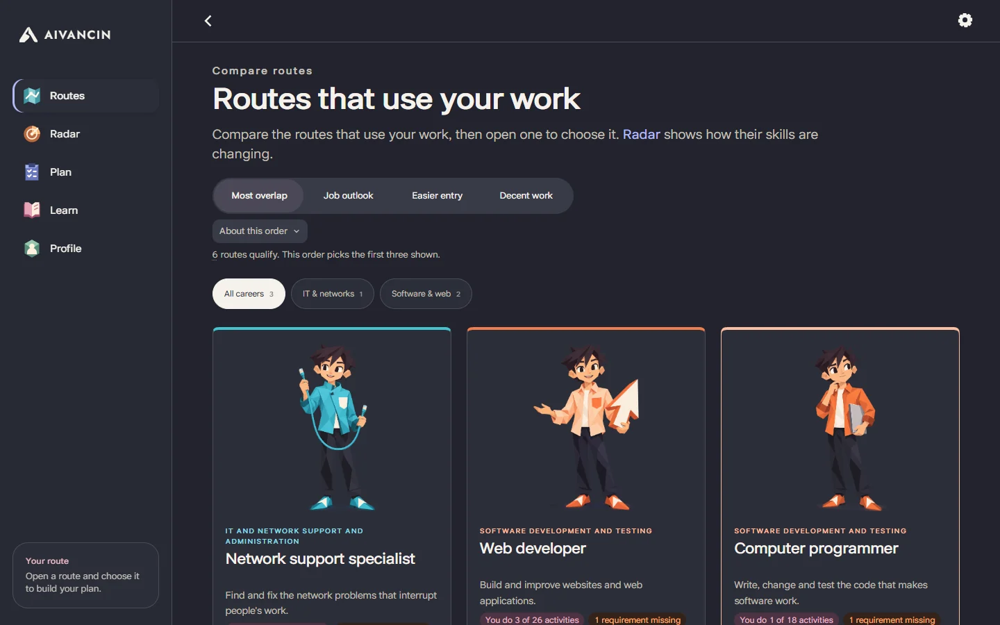
</a>

<br/>
<br/>

<!-- Stack chips -->

<a href="https://www.python.org"></a>
<a href="https://fastapi.tiangolo.com"></a>
<a href="https://onnxruntime.ai"></a>
<a href="https://huggingface.co/sentence-transformers/all-MiniLM-L6-v2"></a>

<a href="https://www.onetonline.org"></a>
<a href="https://replit.com"></a>
<a href="https://www.runpod.io"></a>

</div>

---

<!-- Stats strip -->

<table align="center" width="100%">
  <tr align="center">
    <td><h3>354</h3><sub>Python tests passing</sub></td>
    <td><h3>17</h3><sub>supported destinations</sub></td>
    <td><h3>2,087</h3><sub>O*NET activities</sub></td>
    <td><h3>90</h3><sub>free catalogue courses</sub></td>
    <td><h3>23 MB</h3><sub>encoder, runs on CPU</sub></td>
    <td><h3>5</h3><sub>builders</sub></td>
  </tr>
</table>

> **Status, 28 October 2026:** the team was not selected for the final. The submission is the code at commit `551eeb6`. The commit after it is a UI refresh only: a new visual system, filled icon set, logo and career illustrations, with no change to the matching, data or API code. The live demo still shows the earlier interface.

---

## ▶ Watch the demo

<div align="center">

<a href="https://youtu.be/f3Ue4wpKSeQ" title="Watch the AIVANCIN demo on YouTube">
  
</a>

<br/>

<a href="https://youtu.be/f3Ue4wpKSeQ"></a>

<sub><i>Submission video: a synthetic user describes their work, confirms the suggested activities, compares routes and opens a first learning block.</i></sub>

</div>

---

## TL;DR

- **What.** A career-route finder for underemployed graduates. The user describes their work in their own words, a local sentence encoder suggests the matching O\*NET activities with the sentence behind each, and the user confirms the ones that are true. Roles are then matched by activity overlap, with requirements, AI-usage evidence and a free, link-checked first learning block.
- **Why.** In Q2 2026, 40.7% of employed tertiary-educated Malaysians aged 25-34 (751,100 people) worked in semi- or low-skilled jobs ([DOSM](https://storage.dosm.gov.my/labour/lfs_qtr_sru_age.csv)). Job-title search misses the work they already do, which is what leads to graduate roles.
- **How.** One local ONNX encoder on the server CPU, no API keys and no external calls during use. After the user confirms, matching, requirements, scenarios and plans are deterministic computations from dated sources.
- **Result.** Built for SDC Hackathon 2026 (Team DOVUN, Domain One, SDG 8.5). The team was not selected for the final. The checks passed and failed are listed openly under [Evidence and limitations](#evidence-and-limitations).

## 🔗 Links and artifacts

<table>
  <tr>
    <td>🌐&nbsp;<a href="https://aivancin--jadfahmi.replit.app"><b>Live demo</b></a></td>
    <td><sub>Replit deployment, earlier interface</sub></td>
  </tr>
  <tr>
    <td>🎥&nbsp;<a href="https://youtu.be/f3Ue4wpKSeQ"><b>Demo video</b></a></td>
    <td><sub>The submission walkthrough</sub></td>
  </tr>
  <tr>
    <td>📊&nbsp;<a href="submission/AIVANCIN_Pitch_Deck.pdf"><b>Slide deck</b></a></td>
    <td><sub>Pitch deck, PDF</sub></td>
  </tr>
  <tr>
    <td>💻&nbsp;<a href="https://github.com/AIVANCIN/aivancin"><b>GitHub repository</b></a></td>
    <td><sub>Apache 2.0</sub></td>
  </tr>
  <tr>
    <td>🧾&nbsp;<a href="submission/SDC2026_DOVUN_TechDeclaration.pdf"><b>Technical &amp; Tools Declaration</b></a></td>
    <td><sub>Tools, datasets and licences</sub></td>
  </tr>
  <tr>
    <td>🚀&nbsp;<a href="submission/Replit%20Proof%20of%20Use.pdf"><b>Replit proof of use</b></a></td>
    <td><sub>Deployed from the team leader's Replit account</sub></td>
  </tr>
  <tr>
    <td>⚡&nbsp;<a href="submission/RunPod%20Proof%20of%20Use.pdf"><b>RunPod proof of use</b></a></td>
    <td><sub>One training pod, no endpoint</sub></td>
  </tr>
</table>

## ✨ What it does

<table>
  <tr>
    <td valign="top" width="50%">

### 💬 Describe and confirm
Answer up to four questions about your job, other work, studies, and time and budget. A local all-MiniLM-L6-v2 encoder suggests O\*NET activities with the sentence behind each. You tick what is true.
    </td>
    <td valign="top" width="50%">

### 🧭 Compare destinations
Up to three routes from 17 supported roles in IT support, software, finance and data. Shared activities, entry requirements, the first block and the largest barrier sit side by side.
    </td>
  </tr>
  <tr>
    <td valign="top" width="50%">

### 🔮 Inspect the future evidence
The Future tab and Future Skills Radar separate US job projections, activity demand, observed AI use and Malaysian group statistics under slower, moderate and faster scenarios.
    </td>
    <td valign="top" width="50%">

### 🧱 Start a feasible block
An ordered first learning block fits your weeks, hours and budget. It names the first unit, its output and link-checked free courses, with checkpoints marked Output made, Needs more practice or Stuck.
    </td>
  </tr>
  <tr>
    <td valign="top" width="50%">

### 🔄 Keep control as things change
What changed compares dated evidence bundles for the same work, target and limits. Keep the plan or accept the update. Editing preserves applicable progress, with Cancel and Undo.
    </td>
    <td valign="top" width="50%">

### 🔒 Private and offline by design
No accounts, no API keys and no external calls during use. Answers and progress stay in your browser, and Clear my data removes them. A rule-based guard holds back negated, planned or other people's work for deliberate confirmation.
    </td>
  </tr>
</table>

The interface has Routes, Radar, Plan, Learn and Profile tabs on phones and a sidebar on wide screens, with light and dark appearance, text up to 175%, bold text, increased contrast and reduced motion.

## Project snapshot

| Snapshot | Details |
| --- | --- |
| **Who it's for** | A Malaysian diploma or degree holder aged 25-34 working in a semi- or low-skilled job (for example a van driver, cashier or call-centre agent), before committing to retraining |
| **What works now** | Intake with suggestions, guard and confirmation; route comparison over 17 supported destinations; first learning blocks with practice checkpoints; what-changed comparison between evidence releases; role matching by lane; requirement labels; job outlook with an optional outlook order; AI-usage evidence across four releases with replay; Future Skills Radar tab with four separate signals (US job projections, skill demand, AI shift with time to threshold, Malaysia's observed trend) under slower, moderate and faster scenarios; registered forecasts for the next release to score; plan; SDG tags; a cohort view for career centres on a synthetic cohort; web interface, live at https://aivancin--jadfahmi.replit.app |
| **Demo mode** | Model inference runs live on the CPU from bundled files; data are bundled, dated snapshots; personas are synthetic |
| **Verification date** | Submitted app source checked 23 October 2026; UI refresh checked 28 October 2026 (Windows 11, Python 3.13); historical measurements below keep their own dates |

## 🧪 Try it

| Component | Mode | What it demonstrates |
| --- | --- | --- |
| Live app on Replit | LIVE, earlier interface | The submitted app source with the local encoder on the CPU |
| Local run of this repository | LIVE, current interface | The 28 October UI refresh; see [How to Run](#how-to-run) |
| Demo personas and cohort view | SYNTHETIC | Builder-written people and sentences; no real user data |
| Demo video | RECORDED | Walkthrough of the submitted app |

Open the [live app](https://aivancin--jadfahmi.replit.app), choose **Try an example**, and load Hafiz. Confirm the activities behind his laptop, wifi, software, backup and website work. Compare routes, open Web Developers, inspect Future and choose the route. Plan begins with the next unit and an output, followed by the block and its scenario comparison. The example is synthetic.

For a clear scenario contrast, load Priya, confirm the first two suggestions on each sentence and choose Accountants and Auditors at 6 hours a week. The Plan card compares slower, moderate and faster assumptions, names the checkpoints that add AI checking and keeps the general-ledger prerequisite before daily procedures. These are alternative assumptions, not three observed futures.

**Evidence updates:** Hafiz's current moderate-scenario demo has no changed steps across the bundled releases. What changed reports that honestly. The dedicated offline replay fixture uses a fixed network-administration profile and January/March 2026 evidence; `python tools/checks/replay.py` checks its traceable checkpoint change against a separate raw-data calculation. It demonstrates traceability, not a reliable trend or a Malaysian employment forecast.

## 📸 Screenshots

Captured on 28 October 2026 from the app at this commit, using the synthetic persona Hafiz (scripted Edge, phone 390 x 844, desktop 1440 x 900). The same flow was captured in light and dark appearance.

### Phone

| Welcome | Confirm what we read | Compare routes | Your plan | Radar |
| :---: | :---: | :---: | :---: | :---: |
| 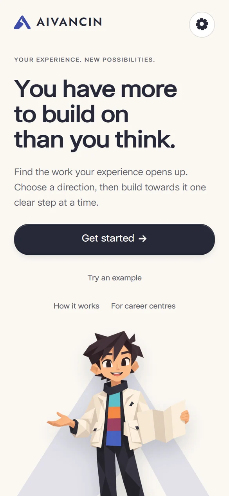 | 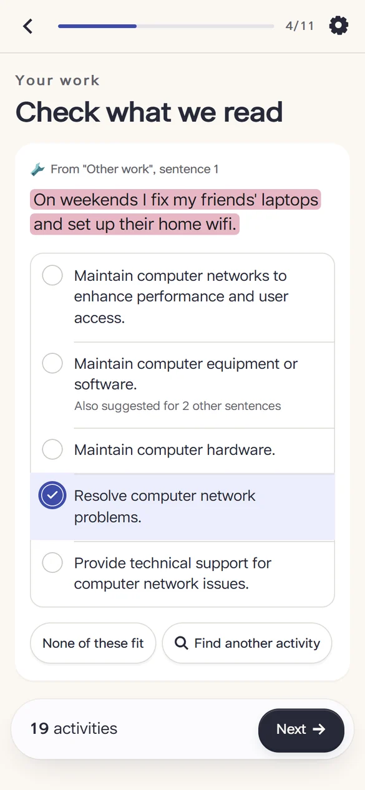 | 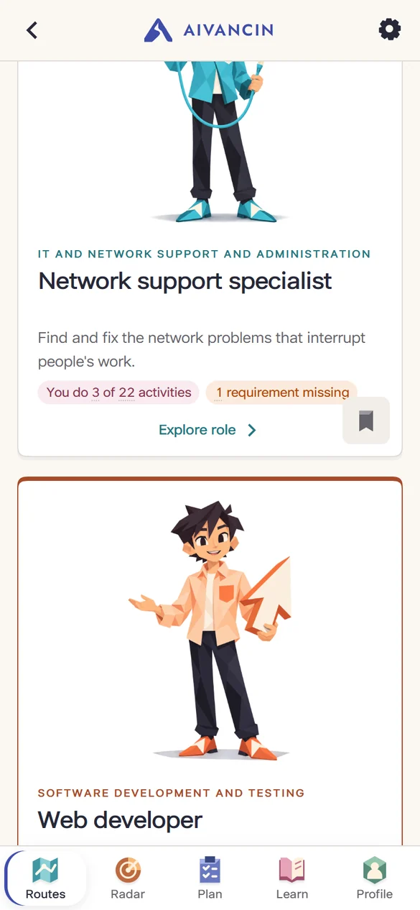 | 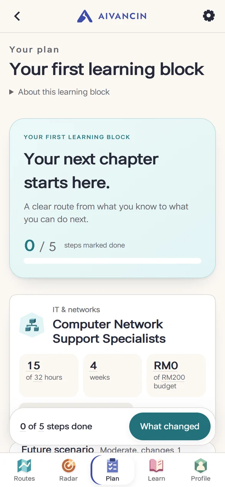 | 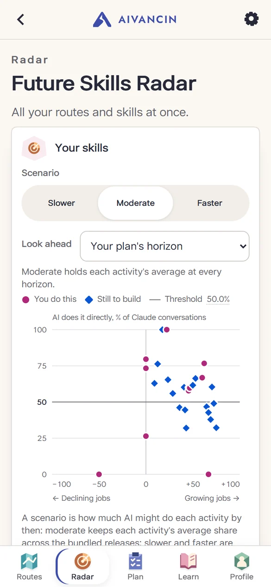 |

Dark appearance:

| Confirm what we read | Compare routes | Your plan |
| :---: | :---: | :---: |
| 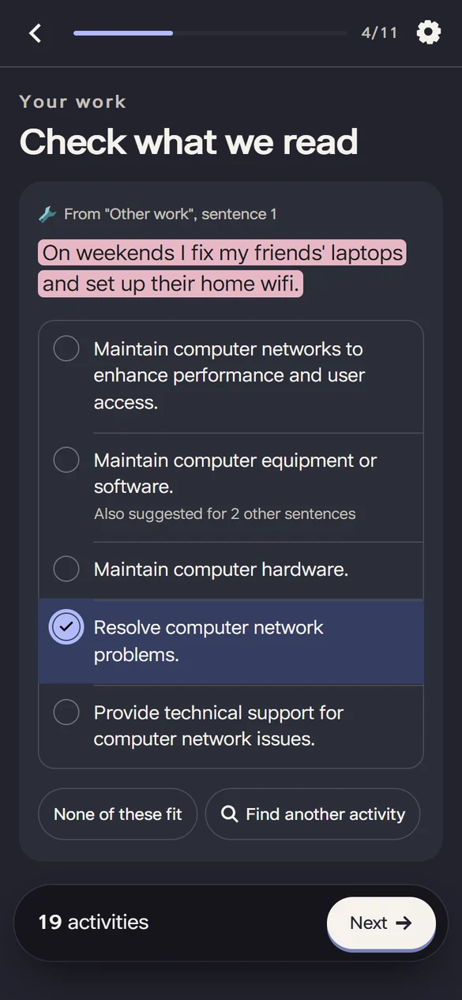 | 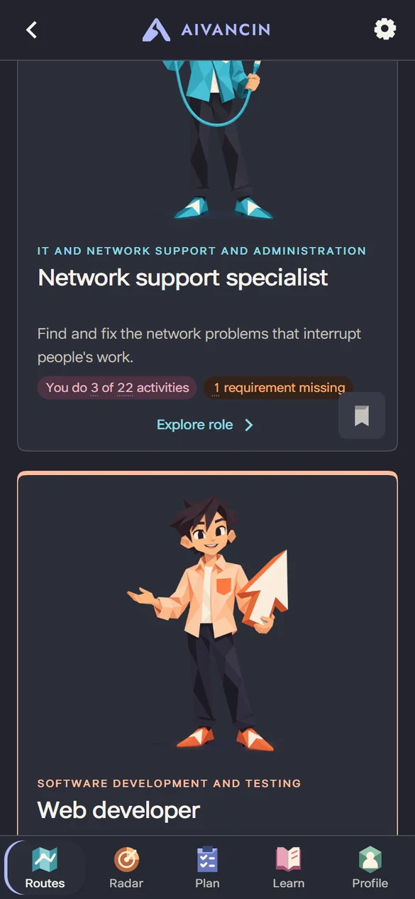 | 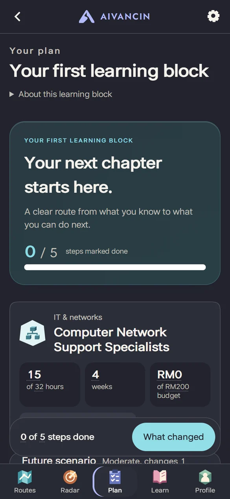 |

### Desktop

| Welcome | Compare routes |
| :---: | :---: |
| 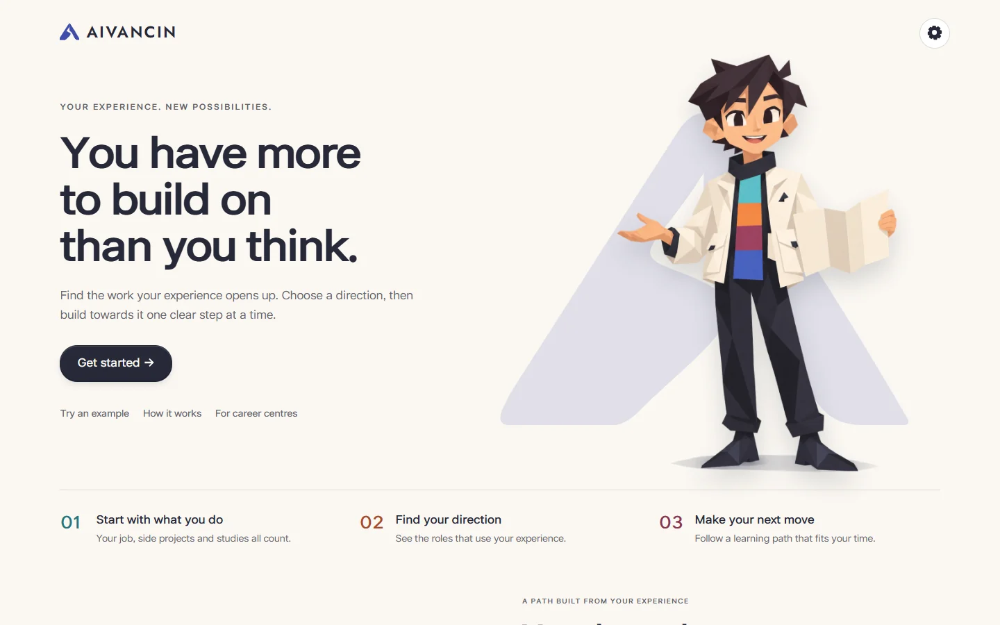 | 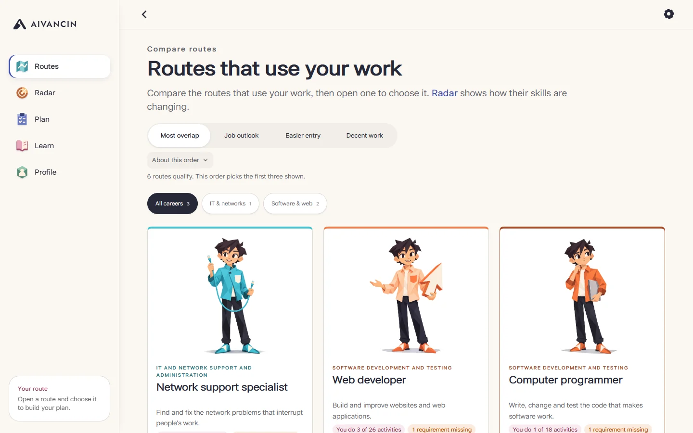 |
| **Your plan** | **Radar** |
| 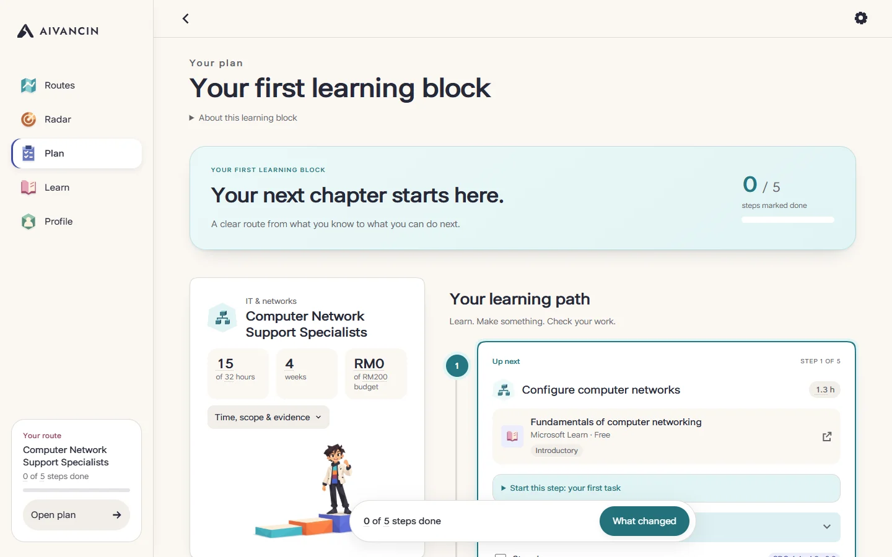 | 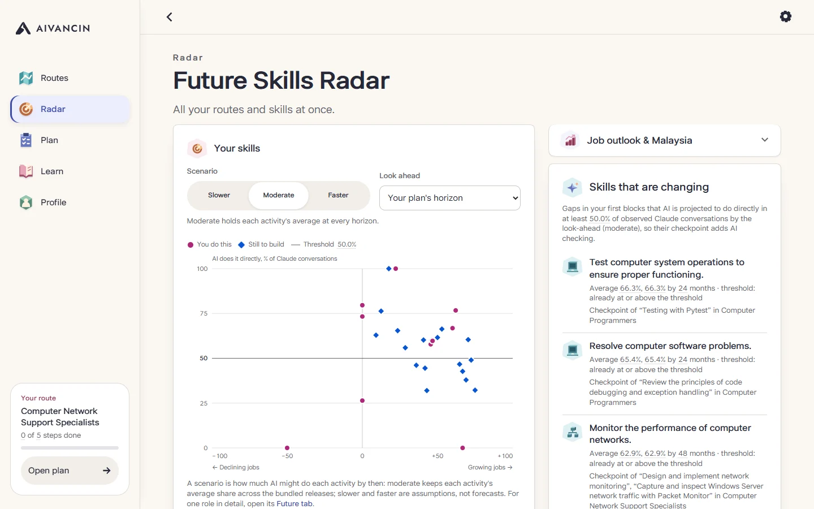 |

Dark appearance on desktop:

| Compare routes | Your plan |
| :---: | :---: |
|  | 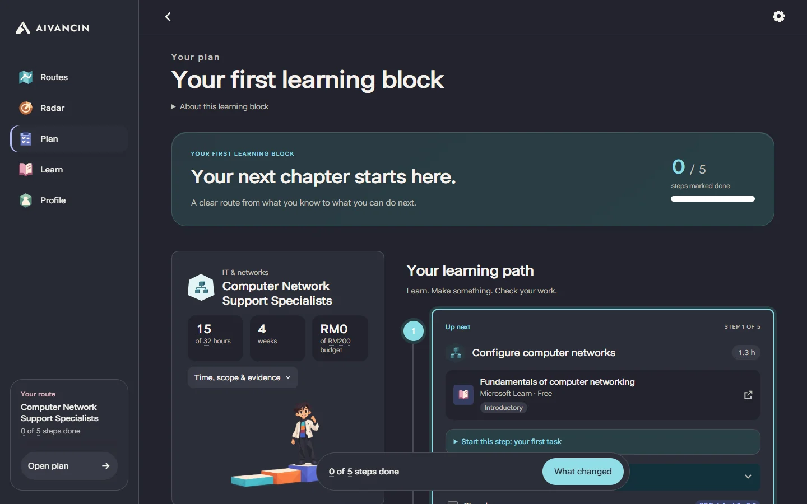 |

## 🏗 Architecture

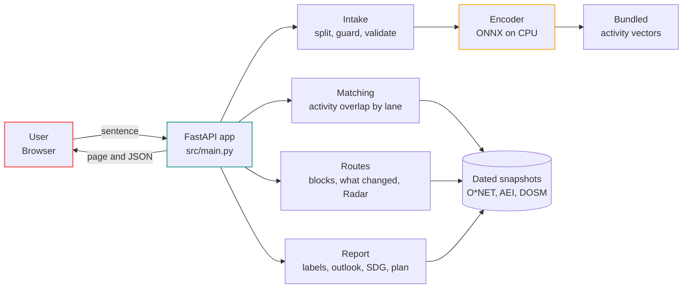

The user's sentence is split and checked by the guard, then compared with 2,087 O\*NET 31.0 activity names and 17,578 linked task statements using the quantized encoder on the server CPU. Everything after confirmation is deterministic, and every number in the page is tagged with its source. Running the encoder locally on precomputed vectors keeps the demo offline, free and reproducible: there is no API key, no per-request cost and no external service to fail.

## 🧰 Stack

<table>
  <tr><th align="left">Layer</th><th align="left">Tools</th></tr>
  <tr>
    <td>Frontend</td>
    <td><b>HTML, CSS and JavaScript</b> without a build step, served by the app · light and dark appearance</td>
  </tr>
  <tr>
    <td>Backend</td>
    <td><b>Python 3.13</b> · <b>FastAPI 0.150</b> · <b>Uvicorn 0.54</b></td>
  </tr>
  <tr>
    <td>Data</td>
    <td>No database. Bundled CSV, JSON and NumPy files: O*NET, AEI, DOSM, crosswalk and catalogue extracts, activity vectors, manifest</td>
  </tr>
  <tr>
    <td>Inference</td>
    <td><b>all-MiniLM-L6-v2</b>, fine-tuned once on a <b>RunPod</b> RTX 4090, run as quantized ONNX on the CPU with <b>ONNX Runtime 1.31</b> and <b>Tokenizers 0.23</b></td>
  </tr>
  <tr>
    <td>Hosting</td>
    <td><b>Replit Deployments</b> (Cloud Run target, Python 3.12 module)</td>
  </tr>
</table>

## Project context

### Problem

In Q2 2026, 40.7% of employed tertiary-educated Malaysians aged 25-34 (751,100 people) worked in semi- or low-skilled jobs ([DOSM `lfs_qtr_sru_age`](https://storage.dosm.gov.my/labour/lfs_qtr_sru_age.csv), CC BY 4.0). Take Hafiz, a synthetic persona: 27, computing diploma, van driver. Searching by his job title points to vehicle-operator roles. His weekends tell a different story: he fixes friends' laptops and wifi, installs software, makes backups and keeps his uncle's shop website updated. That is the work that leads towards graduate roles, and job-title tools never see it.

**The decision we support.** A general chatbot can already suggest plausible roles. AIVANCIN makes the evidence inspectable: each suggestion points to the person's sentence, each route rests on confirmed activity links, and its entry barriers and first learning output can be compared. No live comparison with a general chatbot has been run. The controlled baselines below compare the same synthetic text against title-only and keyword intake.

**Challenge alignment.** Domain One asks for skills intake, an AI-trend signal layer, future-role matching, a reskilling pathway, SDG mapping and handling of uncertainty. Each has a first working version here; the executed checks show an intake contribution, while complete route coverage still misses its target (see Evidence). The SDG link is target 8.5 (productive employment and decent work for young people) through the skill-level step of each role, with a reasoned tag on every plan step: 4.4 (relevant skills) always, 4.3 (affordable learning) when the step is free and 8.2 (productivity through technological upgrading) when it practises directing and checking AI output. A "Decent work (SDG 8.5)" route order and a "How this path contributes" card make the link visible; SDG 5 appears only as national context.

### Solution

1. **Describe and confirm your work.** Answer up to four questions about your job, other work, studies, and time and budget. A local all-MiniLM-L6-v2 encoder suggests O*NET activities with the sentence behind each. You tick what is true, including job-title activities. Examples include their own title confirmations. A skipped qualification stays unknown; skipped hours and budget are labelled planning assumptions. Search and a follow-up question help recover missed work.
2. **Compare destinations.** Up to three routes from 17 supported roles in IT support, software, finance and data. Compare shared activities, entry requirements, the first block and the largest barrier side by side. Orders consider every qualifying route before selecting three. Overlap is a share of recorded activity links, not proficiency or a hiring probability. Limited support and uncovered gaps stay visible.
3. **Inspect the future evidence.** The route's Future tab and Future Skills Radar separate published US job projections, activity demand derived from those jobs, observed global Claude use, and Malaysian group statistics. AI-use averages and latest observations are separate. Slower, moderate and faster scenarios are estimates. The model's forecast direction and calibration checks failed, so no rising/falling AI-use labels are shown.
4. **Start a feasible block.** Choose a route for an ordered first learning block within your weeks, hours and budget. Start here names the exact first unit, setup and output. Courses show prerequisites, access limits, link-check dates and introductory scope. Scenario comparison explains which checkpoints add AI checking and which steps stay fixed. Finished work takes no remaining capacity. Mark a checkpoint as Output made, Needs more practice or Stuck for a next action from verified resources, when one exists.
5. **Keep control as things change.** What changed compares dated evidence bundles with the same work, target, limits and completed steps. Keep the plan or accept the update. In the slower scenario the view also identifies changes in the assumed fall. Editing preserves applicable progress, offers Cancel and Undo, and marks earlier routes until a new comparison is ready. A synthetic cohort view aggregates shared gaps for career centres.

The interface has Routes, Radar, Plan, Learn and Profile tabs on phones and a sidebar on wide screens. Each supported role has its own character illustration on its route card, a guide character leads the welcome and learning screens, and the interface uses a warm light palette and a matching dark one with a filled icon set. Display & accessibility supports device/light/dark appearance, text up to 175%, bold text, increased contrast and reduced motion. Answers and progress stay in this browser; Profile offers Clear my data. No accounts are required.

The encoder is quantized ONNX, about 23 MB, and runs on the server CPU. It compares each sentence with 2,087 O*NET 31.0 activity names and 17,578 linked task statements (70% name, 30% best task score). Sentences over 40 words are also read in windows and clauses and can return up to ten suggestions. A rule-based guard holds back negated, planned, ambiguous or other people's work for deliberate confirmation. Names, ages and gendered words are neutralised in the encoder's copy; work terms such as bookkeeping are expanded. These rules can still miss unfamiliar wording. After confirmation, matching, requirements, scenarios and plans are deterministic computations from dated sources. No generative model runs in the app.

The API at `/docs` includes `/api/suggest`, `/api/profile`, `/api/results`, `/api/routes`, `/api/update` and `/api/cohort`. Wrong-shaped input returns field errors (422); missing or mismatched inference assets leave keyword search available. Dataset hash mismatches stop startup.

## What is implemented

| Capability | Verification entry point |
| --- | --- |
| Sentence suggestions, title opt-in, guard, unknown answers and bounded input | `tests/test_intake.py`, `tests/test_review_fixes.py` |
| Confirmation, rejection, recovery and model-unavailable fallback | `tests/test_app_and_failures.py`, `tests/test_intake.py` |
| Activity matching, requirements, lanes, route orders and comparison | `tests/test_matching_and_report.py`, `tests/test_routes.py`, `tests/test_review_fixes.py` |
| First blocks, course access, completed work and evidence updates | `tests/test_routes.py`, `tests/test_keep_accept.py`, `tests/test_replay.py` |
| Future signals, scenarios, sourced figures and registered forecasts | `tests/test_forecast.py`, `tools/checks/forecast_checks.py` |
| Reasoned SDG contribution and decent-work order | `tests/test_sdg.py` |
| Names, gender and age invariance on declared synthetic pairs | `tests/test_fairness.py`, `tools/checks/c13_fairness.py` |
| Synthetic cohort aggregation, provenance and isolation | `tests/test_cohort.py` |
| Source watch, run manually | `tests/test_source_watch.py`, `tools/check_sources.py` |
| RunPod fine-tuning and shipping gate | `tools/finetune/`, `data/model/finetune.json` |
| Motion and display preferences | `node --test tests/motion.test.cjs tests/display.test.cjs` |

## Evidence and limitations

All evaluation people and sentences below are synthetic and builder-written. These checks establish prototype behaviour on those inputs. Real-user learning, employment and usability outcomes have not been measured.

| Check | Result | Date, method and interpretation |
| --- | --- | --- |
| Core path and recovery | **PASS, 354/354** Python tests; **14/14** Node tests | 23 Oct 2026, submitted app source; rerun 28 Oct 2026 on the UI refresh with the same counts. `python -m pytest`; Node command above. Offline, including malformed input, hash failures, fallback, accounting and saved state. |
| Suggestion accuracy (A1) | **PASS, 20/20** on each of two sets | Re-run 23 Oct, `python tools/checks/a1_a3.py [result.json] [sets.json]`. Both sets guided earlier changes; these reruns are regression evidence. |
| Complete chain and keyword baseline (A2/A3) | **A2 FAIL:** 32/50 relevant top-five roles, but 5/10 people with at least three (bar: 7). **A3 PASS:** 32 against 20 keyword roles (margin 12; bar: 10). | 23 Oct, same text, strict simulated confirmation, other-work lane. `tools/checks/a1_a3.py`. The guard fix also helped the keyword baseline; the older 32:16 comparison no longer describes this source. |
| Route-and-block target (B7, newest set 8) | **FAIL, 7/12 (58.3%)**, target 80%. Same people: title-only 0/12, BM25 2/12. All 4 out-of-scope controls pass; 0 invalid blocks and 0 errors. | `python tools/checks/fresh_eval.py`, 23 Oct. Profiles committed before first run; all three modes affirm the same title activities. First run: 7/12 with 28/57 true activities confirmed; final-source rerun after negation fixes: 7/12 with 31/57. Final run has 21 relevant and 5 off-family routes among in-scope people. The rerun is not independent. |
| Long sentences | **REPORTED:** 27/31 labelled activities suggested, versus 11/31 before; work in the final third reached in 11/11 sentences, versus 6/11. | 23 Oct, `tools/checks/long_sentences.py`, predeclared set. Multiple repair runs used the set, so these are development results. Suggestion recovery does not prove correct routes. |
| Negation scope | **PASS on final development run:** 8/8 own-work controls kept; 8/8 negations held. | 23 Oct, `tools/checks/negation_scope.py`. Before: 1/8 own-work controls kept. Predeclared set guided repairs. |
| Guard, separate set 4 | **FAIL, 8/14** non-work/planned/failed-attempt sentences held; **13/13** own-work controls kept. | 21 Oct first run, unchanged in the 23 Oct regression. `tools/checks/a6_guard.py`. Some pastimes and dated plans still pass the guard. |
| No-dead-end behaviour (C15) | **FAIL, 5/6** original out-of-scope profiles get exploration instead of routes. | `tests/test_no_dead_end.py` pins the known exception: a home baker reaches two finance routes through two different true activities. The minimum-two-activity rule remains unchanged. Set 8's 4/4 result is a separate check. |
| Fine-tuning gate (A17) | **PASS at shipping:** 45/60 held-out descriptions versus 39 base and 40 export-control; chain regression 32/50 versus 31. | 21 Oct, `tools/finetune/evaluate.py`. Gate fixed before one RunPod run. Later intake rules were not part of this training comparison. |
| Forecast signals and provenance | **PASS:** 1,721 skill-demand values separately reproduced; 30,810 sourced Radar/Future figures in the declared C6 cases. | 21 Oct, `tools/checks/forecast_checks.py`, `tests/test_forecast.py -k c6`. Rendered C16 regression 23 Oct: 4/4 viewport/theme runs, 22 screens each. |
| AI-use forecast quality (A18) | **FAIL direction/calibration gates:** historical-average MAE 16.33 percentage points; 80% error band 25.96 points. | `tools/checks/a18_backtest.py`, 21 Oct, predicting June from three older releases. Last-value MAE 17.81, trend-line 22.0; only 31.9% of 364 past changes continued. One target release across a format change. Scenarios are rough assumptions. |
| Cohort aggregation | **PASS:** 60 synthetic members, 50 with a route; 48/50 first routes lead to skilled work; 183 gaps served, 224/224 steps free, 118 AI-checking checkpoints. | Current bundled cohort, computed 23 Oct; aggregation verified by `tests/test_cohort.py`. These describe suggested blocks, not completed learning or employment. |
| Rendered interface | **PASS:** latest feature checks 22/22; UI/UX 43/43; C16 4/4; UI and design 8/8 each. | 23 Oct, scripted Edge, phone/desktop viewports, light/dark and large text. Four relevant injected faults were rejected. Emulated viewports do not verify physical devices or screen readers. The 28 Oct UI refresh was captured through the same Hafiz flow in 4 phone/desktop and light/dark runs (32 screens): no console errors, failed requests or horizontal overflow. The earlier feature and accessibility checks above were not rerun on it. |
| Target-user benefit, physical devices and screen readers | **NOT RUN** | No user-outcome claim. |

### Known limits

- **Supported scope:** English intake and 17 destinations in IT support, software, finance and data. Missing casual wording and off-family routes remain the hardest risk. Search, follow-up and explicit exploration states provide recovery; confirmation takes effort.
- **Guard:** rules inspect ownership and the person's own negation, but do not understand every phrasing. Each suggestion still needs confirmation. A model match is not proof of experience or proficiency.
- **Local relevance:** roles, activities, qualifications and job projections come from the United States. DOSM provides Malaysian observed statistics at broad occupation/skill-group level, not a Malaysian occupation forecast, vacancy count or individual salary. The crosswalk leaves 81/940 occupations unmapped. Local occupation-level validation is the first next step. MyCOL and MyMahir material stays excluded until reuse permission is confirmed.
- **Resources:** 90 free catalogue entries, with link validity checked 22 Oct (88 passed; two already failed). Unverified or expired entries cannot support a block. Some finance modules are product-specific; the app distinguishes free reading from paid provider exercises and supplies a free checkpoint. Tax-return preparation still has no verified free course. Introductory modules are labelled as a first look, not enough practice on their own.
- **Future evidence:** global Claude conversations measure use of one product, not Malaysian labour demand. Historical activity averages and the latest release are shown separately. Older task text matches about 83% to O*NET; unmatched tasks are omitted. BLS projections inherit US uncertainty. The moderate AI-use forecast has large error and uncalibrated ranges; faster/slower assumptions are not observations.
- **Operations:** one host, no redundancy. No deployment latency or memory benchmark; no real-user learning or employment validation. The app is a decision aid, not recruitment or placement.

### Privacy, safety and reliability

- **Data:** text is processed in memory for the request and not stored or logged by the server. Your answers, confirmed activities, chosen route, ticked steps and saved routes are kept in your browser's local storage so you can continue later; Clear my data in Profile removes them. There are no accounts. Demo personas and the cohort view's members are synthetic; the cohort view accepts no upload.
- **Sharing:** none. The server makes no external model or data API calls during use; browser requests go to the app itself, and inference runs on its CPU. The source watch (`tools/check_sources.py`) reads public release pages only when someone runs it. Course and job-search links open the other site only when the user clicks them.
- **Security:** inputs are validated server-side, and the server recomputes suggestions rather than trusting the client. No secrets are needed or stored.
- **Failure behaviour:** a missing or altered model, tokenizer or vector file switches to keyword search with a clear message; an altered dataset file stops the app at start-up rather than serving wrong data.

## 🗂 Repository layout

```
.
├── assets/icon/            # App icon and logo
├── assets/art/             # Welcome artwork, explainer scenes and the career illustrations (illustrations/vance/)
├── assets/screenshots/     # Interface screenshots used in this README
├── assets/fonts/           # KL Pro (separate licence) and Jost (OFL 1.1) web fonts
├── data/                   # Bundled snapshots: manifest.json, onet/, aei/, dosm/, crosswalk/, catalogue/, forecast/, model/, vectors/, personas.json
├── src/
│   ├── main.py             # Application entry point
│   └── aivancin/           # snapshots, encoder, intake, matching, aei, report, pathway, routes, cohort, app; static/ holds the web interface
├── submission/             # Proposal, Technical & Tools Declaration, Replit and RunPod proof, pitch deck
├── tests/                  # Offline tests
├── tools/
│   ├── build_snapshots.py  # Rebuilds data/ from the original sources
│   ├── build_catalogue.py  # Rebuilds the course catalogue, link checks, provider objectives and unit lists
│   ├── build_routes.py     # Builds the supported destinations and applies the admission rule
│   ├── build_cohort.py     # Builds the synthetic cohort for the cohort view from the B7 test profiles
│   ├── destinations_curation.json  # Supported destinations and candidates; build_routes.py applies the admission rule
│   ├── fetch_outlook.py    # Caches O*NET OnLine job-outlook pages for the snapshot
│   ├── export_forecasts.py # Freezes the skill-outlook forecasts for scoring against the next release
│   ├── check_sources.py    # Source watch: each bundled source against its upstream version
│   ├── finetune/           # RunPod encoder fine-tuning: pairs, training script, local gate
│   ├── checks/a18_backtest.py  # Skill-outlook backtest behind the displayed error; --prospective scores registered forecasts
│   ├── checks/forecast_checks.py  # C1-C5: forecast signals recomputed separately
│   ├── checks/replay.py    # Evidence-to-plan replay: one update, 12 checks
│   └── catalogue_curation.json  # Curated course-to-activity links, checkpoints and what each checkpoint needs
├── .env.example            # Optional HOST and PORT
├── .gitignore
├── .replit                 # Replit run configuration
├── LICENSE
├── pyproject.toml          # Test configuration
├── requirements.txt        # Runtime dependencies
├── requirements-dev.txt    # Runtime plus test dependencies
└── README.md
```

## How to Run

### Option 1: Run on Replit (Recommended)

1. Open the live deployment at https://aivancin--jadfahmi.replit.app, or import this repository via **Create Repl → Import from GitHub**.
2. No secrets are needed.
3. Click **Run**. Replit uses `.replit` to start `python src/main.py` on its Python 3.12 module.

Deployment check, 23 October 2026: the published app answered `/api/status` successfully, and its `app.js` and `app.css` matched the source at that check. The deployment has not been republished since, so it does not include the 28 October UI refresh; run the repository locally to see it.

### Illustrations

Illustrations sit in `assets/art/`. Four explainer scenes cover informal-work examples, activity confirmation, the workflow overview and choosing a route before building a learning plan. `assets/art/illustrations/vance/` holds the guide character and one scene per supported role, used on the route cards, in the learning path and on the confirmation and welcome screens. Images keep their proportions and padding; native text and controls keep the workflow usable if an image does not load.

### Option 2: Run Locally

**Prerequisites:** Python 3.13 (the Replit deployment runs 3.12; other versions untested). No accounts, keys or paid services.
**Verified on:** a fresh clone, Windows 11, Python 3.13, 22 October 2026 (install, start, `/api/status` and `/api/suggest`).

```bash
git clone https://github.com/AIVANCIN/aivancin.git
cd aivancin
python -m venv venv
source venv/bin/activate        # Windows: venv\Scripts\activate
pip install -r requirements.txt
python src/main.py
```

Open **http://127.0.0.1:8000/** for the app, or **http://127.0.0.1:8000/docs** for the API.

### Run Tests

```bash
pip install -r requirements-dev.txt
python -m pytest
```

**Expected result:** `354 passed` (23 Oct 2026, rerun 28 Oct 2026). Tests run offline; outbound network access is blocked.
**Rebuild the data (optional):** `python tools/build_snapshots.py` downloads the original files into `.cache/` and rebuilds `data/`; pinned files (model, AEI releases) are checked against their hashes, while live sources such as DOSM and the ESCO API can change. `python tools/build_catalogue.py` refreshes the course list and its link checks.

## How We Use Replit *(Required)*

Replit hosts the live prototype judges use: **https://aivancin--jadfahmi.replit.app**, published from the team leader's Replit account.

- **How it was set up:** the repository was imported into Replit, and Replit Agent configured the run settings (`.replit`: the Python 3.12 module, port 8000 served on 80, a Cloud Run deployment target running `python src/main.py`) and published the app; its commits ("Configure Replit environment settings", "Published your App") are in this repository's history.
- **What runs there:** the finished preliminary feature set, including the fine-tuned encoder on the CPU. The repository's measured-check ledger was refreshed on 23 October; that documentation metadata needs a Replit republish to appear in the app's How it works sheet. The app needs no secrets, database or external service, and it makes no outbound calls.
- **Proof:** [submission/Replit Proof of Use.pdf](submission/Replit%20Proof%20of%20Use.pdf), also Appendix C of the Technical & Tools Declaration.

## How We Use RunPod *(Required)*

One GPU training job, no endpoint: the app never calls RunPod, and the fine-tuned model is bundled and runs on the CPU.

- **What ran:** on 21 Oct 2026 we fine-tuned the sentence encoder on an on-demand pod from the team's RunPod credit: pod `82gxhhkg2yedbz`, NVIDIA GeForce RTX 4090, Secure Cloud, image `runpod/pytorch:2.8.0-py3.11-cuda12.8.1-cudnn-devel-ubuntu22.04`. `tools/finetune/train.py` trained on 21,397 pairs built from O\*NET's 24,087 task-to-activity links (one epoch, contrastive loss, settings fixed before the run) in 15.6 seconds, 25.5 seconds with both model exports. The pod ran for about 28 minutes including setup and download and cost US$0.42.
- **How it was judged:** locally on the CPU with the app's own scoring, against a gate written before training: 45 of 60 held-out casual descriptions with a correct activity in the top five, against 39 for the original model and 40 for the base model put through the same export; the earlier complete-chain regression not lower (32 of 50 against 31). The held-out sentences never went to the pod.
- **Proof:** [submission/RunPod Proof of Use.pdf](submission/RunPod%20Proof%20of%20Use.pdf) (pod ID, GPU type, runtime and cost from the team's RunPod dashboard), also Appendix B of the Technical & Tools Declaration.
- **What changed:** the tuned model replaced `data/model/model.onnx`; the activity and task-statement vectors and the route sibling tables were recomputed for it. The record (pod, GPU, runtime, cost, training data and model hashes, gate results) is `data/model/finetune.json`, with `tools/finetune/run_20261021T1047Z.json` and `tools/finetune/gate_20261021T1047Z.json`; the snapshot builder refuses model files that do not match it.

## Challenges & Learnings

- **Unreliable downloads:** the O\*NET server sometimes cut large files short, so the snapshot builder checks the length and falls back to byte-range downloads.
- **Hashes and line endings:** Git on Windows rewrote line endings in hashed data files; `.gitattributes` now keeps `data/` byte-exact so the hash checks hold on every checkout.
- **Testing the fallback:** a test for a missing model file showed the app crashed instead of falling back; the loader now reports "AI suggestions unavailable" and the test guards it.

## Future Improvements

- [ ] Validate role requirements, activity mappings and opportunity evidence against Malaysian occupation-level sources with confirmed reuse rights.
- [ ] Memory, start-up and latency measurements on the Replit deployment.
- [ ] A second fine-tuning round with casual paraphrases, judged on a new held-out set written before it.
- [ ] Malaysian entry requirements and MyCOL or MyMahir evidence, once their reuse permission is confirmed.
- [ ] Malay descriptions, after their own checked test set passes.
- [ ] Testing with real underemployed graduates.

## 👥 Team

<table>
  <tr>
    <td align="center" valign="top" width="20%">
      <h4>Jad Fahmi</h4>
      <sub><i>Team Lead &amp; Developer</i></sub>
      <br/><br/>
      <a href="https://github.com/jad-fahmi">@jad-fahmi</a>
      <br/><br/>
      <sub>Coordinates delivery and leads implementation.</sub>
    </td>
    <td align="center" valign="top" width="20%">
      <h4>Aqil Amin</h4>
      <sub><i>Quality Assurance Tester</i></sub>
      <br/><br/>
      <a href="https://github.com/fakebat2-da">@fakebat2-da</a>
      <br/><br/>
      <sub>Tests user flows, reproduces defects and reports findings.</sub>
    </td>
    <td align="center" valign="top" width="20%">
      <h4>Khairin Darwisy</h4>
      <sub><i>Quality Assurance Tester</i></sub>
      <br/><br/>
      <a href="https://github.com/KhaiWisy">@KhaiWisy</a>
      <br/><br/>
      <sub>Tests user flows, reproduces defects and reports findings.</sub>
    </td>
    <td align="center" valign="top" width="20%">
      <h4>Adam Hasif</h4>
      <sub><i>Documentation Website Developer</i></sub>
      <br/><br/>
      <a href="https://github.com/Lukecyan1">@Lukecyan1</a>
      <br/><br/>
      <sub>Builds and maintains the project's documentation website.</sub>
    </td>
    <td align="center" valign="top" width="20%">
      <h4>Ammar Hakeem</h4>
      <sub><i>Documentation Website Developer</i></sub>
      <br/><br/>
      <sub>GitHub account pending</sub>
      <br/><br/>
      <sub>Builds and maintains the project's documentation website.</sub>
    </td>
  </tr>
</table>

## 🪪 Team information

| Field | Details |
| --- | --- |
| **Team Name** | DOVUN |
| **Team Domain** | Domain 1: The Aiversecity Future-Ready Workforce Domain |
| **SDG Track (1-17)** | SDG 8: Decent Work and Economic Growth (target 8.5) |
| **Team Leader** | Jad Fahmi |
| **University** | German-Malaysian Institute |
| **Number of Members** | 5 |

## Credits, dependencies and AI disclosure

The product code, tests and synthetic personas were written during the event. The app icon was designed by Jad Fahmi; the welcome artwork was generated with ChatGPT image generation (OpenAI GPT image). Jad supplied the interface illustrations: the four explainer scenes, which were fitted to their UI slots using proportional resizing and transparent padding, and the guide character and career scenes in `assets/art/illustrations/vance/`. Development used AI assistants: Claude Code (Claude Opus 5.5 and Sonnet 5.5) for most code, tests, documentation, the submission documents and the demo video assembly; Codex (OpenAI GPT-6 family) for project-selection research, early interface work, proposal and deck drafts, and the final documentation/submission refresh; Antigravity (Google Gemini) for documentation-website work and a design review; and Replit Agent for the Replit run settings and publishing. The team directs the work and reviews the output; the evidence section identifies the checks actually run and retains failed quality gates. The product's own AI is the local all-MiniLM-L6-v2 encoder described above. All of these are listed in the Technical & Tools Declaration ([submission/SDC2026_DOVUN_TechDeclaration.pdf](submission/SDC2026_DOVUN_TechDeclaration.pdf)).

| Resource | Origin and rights | How it was actually used | Declaration / approval |
| --- | --- | --- | --- |
| README structure | Official SDC sample README, merged with a pre-event team template (presentation inspired by Givlah) | Section structure only | Declared as pre-existing material in the proposal |
| O\*NET 31.0 Database | USDOL/ETA, [CC BY 4.0](https://creativecommons.org/licenses/by/4.0/), files dated 25 Aug 2026 | Work activities, occupations, tasks, task-to-activity links, job zones | Declared in the Technical & Tools Declaration |
| all-MiniLM-L6-v2 | sentence-transformers, [Apache 2.0](https://huggingface.co/sentence-transformers/all-MiniLM-L6-v2), revision `1110a243` | Local sentence encoder, fine-tuned by the team on O\*NET 31.0 task-to-activity links (Apache 2.0 permits modification) | Declared in the Technical & Tools Declaration |
| FastAPI, Uvicorn, ONNX Runtime, Tokenizers, NumPy | Open-source: MIT (FastAPI, ONNX Runtime), BSD-3-Clause (Uvicorn, NumPy, which also bundles 0BSD, MIT, Zlib and CC0 parts), Apache 2.0 (Tokenizers) | API server, model runtime, tokenization, vector search | Declared in the Technical & Tools Declaration |
| pytest, HTTPX | Open-source: MIT (pytest), BSD-3-Clause (HTTPX) | Tests only | Declared in the Technical & Tools Declaration |
| PyTorch, Sentence Transformers, Transformers, Datasets, Accelerate, ONNX | Open-source: BSD-3-Clause (PyTorch), Apache 2.0 (the others) | Fine-tuning and export on the RunPod pod only (`tools/finetune/requirements-runpod.txt`); not app dependencies | Declared in the Technical & Tools Declaration |
| RunPod | RunPod, team account on the event's US$25 credit | One GPU training pod (see [How We Use RunPod](#how-we-use-runpod-required)) | Declared in the Technical & Tools Declaration |
| Anthropic Economic Index, four releases (Sep 2025 to Jun 2026) | Anthropic, CC BY (as recorded in `data/manifest.json`) | Share of Claude conversations on each task where AI does the work directly: evidence, replay and skill outlook | Declared in the Technical & Tools Declaration |
| OpenDOSM wages and skill-related underemployment | Department of Statistics Malaysia, CC BY 4.0 | Pay steps by MASCO major group; the problem baseline | Declared in the Technical & Tools Declaration |
| ESCO O\*NET-ISCO crosswalk and ESCO API | European Commission, reuse with attribution under Commission Decision 2011/833/EU | Mapping occupations to ISCO and MASCO major groups | Declared in the Technical & Tools Declaration |
| NCES CIP-SOC crosswalk | U.S. NCES and BLS, public domain | Field of study to occupations (studies lane) | Declared in the Technical & Tools Declaration |
| O\*NET OnLine job outlook | USDOL/ETA with BLS 2025-2035 projections, CC BY 4.0 | US projected-growth bands and Bright Outlook flags | Declared in the Technical & Tools Declaration |
| Microsoft Learn and Saylor University course pages | Microsoft; Saylor University, run by the Constitution Foundation (Saylor-authored content CC BY 3.0, final exams excluded) | Linked, not copied: title, stated duration and stated objectives of each catalogue entry | Declared in the Technical & Tools Declaration |
| KL Pro typeface | Created for Dovun before the event (October 2026); all rights reserved, separate licence in `assets/fonts/kl-pro/LICENSE.txt`, not covered by Apache 2.0 | Interface typeface; the four web font files, unmodified | Declared as pre-existing material in the proposal |
| Jost | Owen Earl and the Jost Project Authors, [SIL Open Font License 1.1](assets/fonts/jost/OFL.txt) | Wordmark only: SemiBold (600) instance, cut to Basic Latin | Declared in the Technical & Tools Declaration |
| Replit | Replit, team leader's account | Hosting the live prototype (see How We Use Replit) | Declared in the Technical & Tools Declaration |
| Claude Code (Claude Opus 5.5, Sonnet 5.5) | Anthropic | Development assistance (major), reviewed by the team | Declared in the Technical & Tools Declaration |
| Codex (GPT-6 family) | OpenAI | Selection research, early interface work, proposal/deck drafts and final documentation/submission refresh (moderate) | Declared in the Technical & Tools Declaration |
| Antigravity (Gemini) | Google | Documentation-website work and a design review (minor) | Declared in the Technical & Tools Declaration |
| Replit Agent | Replit | Replit run settings and publishing (minor) | Declared in the Technical & Tools Declaration |
| ChatGPT image generation (GPT image) | OpenAI | Welcome artwork in `assets/art/` (minor) | Declared in the Technical & Tools Declaration |

This product includes information from the O\*NET 31.0 Database by the U.S. Department of Labor, Employment and Training Administration (USDOL/ETA). Used under the CC BY 4.0 license. O\*NET® is a trademark of USDOL/ETA. AIVANCIN has modified all or some of this information (column selection and sorting, and task-to-activity pairs used to fine-tune the encoder). USDOL/ETA has not approved, endorsed, or tested these modifications. Every snapshot's source URL, release, access date, licence and SHA-256 hashes are in `data/manifest.json`.

## Submission Checklist

- [x] Team name, domain (Domain 1) and SDG track filled in
- [x] Slide deck link added
- [x] Demo video link added
- [x] Replit used, with proof of use in `submission/`
- [x] RunPod used, with proof of use in `submission/` (or non-use explained)
- [x] Proposal and Technical & Tools Declaration prepared in `submission/`
- [x] Signed copies of the proposal and declaration in `submission/`; final platform submission made
- [x] "How to Run" steps verified from a clean checkout
- [x] No API keys or secrets committed to the repository

## License

This project is licensed under the [Apache License 2.0](LICENSE). Third-party components and datasets keep their own licences. The KL Pro font files in `assets/fonts/kl-pro/` are not covered by the Apache License 2.0; see their own licence file.

<div align="center">
<br/>
<sub>Built for SDC Hackathon 2026 · Team DOVUN · Domain One: The Aiversecity Future-Ready Workforce Domain · SDG 8.5</sub>
<br/>
<sub><a href="https://aivancin--jadfahmi.replit.app">aivancin--jadfahmi.replit.app</a> · <a href="https://github.com/AIVANCIN/aivancin">github.com/AIVANCIN/aivancin</a></sub>
</div>
