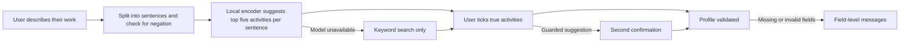

<div align="center">


# AIVANCIN

### From the work you already do to the closest graduate roles, for underemployed Malaysian graduates.

You describe what you actually do, in your own words. An AI suggests the matching work activities, you confirm the ones that are true, and AIVANCIN shows the closest graduate-level roles that use that work, what each still requires, what AI is already doing in those tasks, and a free, verified plan for the gaps.

<sub>Built for SDC Hackathon 2026 · Team DOVUN · Domain One: The Aiversecity Future-Ready Workforce Domain</sub>

**[Run locally](#how-to-run)** · Live demo and demo video: not yet available

</div>

## Team Information

| Field | Details |
| --- | --- |
| **Team Name** | DOVUN |
| **Team Domain** | Domain 1: The Aiversecity Future-Ready Workforce Domain |
| **SDG Track (1-17)** | SDG 8: Decent Work and Economic Growth (target 8.5) |
| **Team Leader** | Jad Fahmi |
| **University** | German-Malaysian Institute |
| **Number of Members** | 5 |

## Links

| Resource | Link |
| --- | --- |
| GitHub Repository | https://github.com/AIVANCIN/aivancin |
| Replit Project | Not yet available |
| Live Demo | Not yet available |
| RunPod Endpoint | Not yet available |
| Slide Deck | Not yet available |
| Demo Video | Not yet available |

---

## Overview

> **The problem:** many Malaysian graduates work in jobs below their qualification, and before spending evenings and savings on retraining they cannot easily see which graduate-level job is closest to what they already do.  
> **Our approach:** read the user's own description of their work, suggest the matching O\*NET work activities with a local AI model, let the user confirm each one, then match roles by activity overlap.  
> **The result today:** a working web app, run locally from bundled files: free text in, activity suggestions with the sentence that triggered each, a guard against "I have never..." statements and confirmation; then up to three supported career routes compared side by side, a chosen route's first learning block that fits your weeks, hours and budget, and what changes when the AI-usage evidence changes. An exploration view still lists the closest graduate-level roles by activity overlap, each with requirement labels, a US job outlook, dated AI-usage evidence, a Future Skills Radar projecting how each activity shifts under three scenarios, a DOSM pay step, SDG reasons and a plan from link-checked free courses.

| Snapshot | Details |
| --- | --- |
| **Who it's for** | A Malaysian diploma or degree holder aged 25-34 working in a semi- or low-skilled job (for example a van driver, cashier or call-centre agent), before committing to retraining |
| **What works now** | Intake with suggestions, guard and confirmation; route comparison over 12 supported destinations; first learning blocks with practice checkpoints; what-changed comparison between evidence releases; role matching by lane; requirement labels; job outlook with an optional outlook order; AI-usage evidence across four releases with replay; Future Skills Radar with slower, moderate and faster scenarios; plan; SDG tags; web interface (not yet deployed) |
| **Demo mode** | Model inference runs live on the CPU from bundled files; data are bundled, dated snapshots; personas are synthetic |
| **Reviewed revision** | Checks below were run on 20 October 2026 (Windows 11, Python 3.13) |

### Problem

In Q2 2026, 40.7% of employed tertiary-educated Malaysians aged 25-34 (751,100 people) worked in semi- or low-skilled jobs ([DOSM `lfs_qtr_sru_age`](https://storage.dosm.gov.my/labour/lfs_qtr_sru_age.csv), CC BY 4.0). Take Hafiz, a synthetic persona: 27, computing diploma, van driver. Searching by his job title points to vehicle-operator roles. His weekends tell a different story: he fixes friends' laptops and wifi, installs software, makes backups and keeps his uncle's shop website updated. That is the work that leads towards graduate roles, and job-title tools never see it.

**What people do today.** A general chatbot can suggest plausible roles and even cite AI-usage figures, but its narrative advice varies between runs and does not show which recorded activities the match rests on. Skills platforms such as MyMahir ask the user to pick a target role first.

**What it does not solve here.** Turning casual descriptions of side work into checkable, confirmed activity evidence, and ranking roles reproducibly from that evidence.

**Challenge alignment.** Domain One asks for skills intake, an AI-trend signal layer, future-role matching, a reskilling pathway, SDG mapping and handling of uncertainty. Each has a first working version here; on fresh synthetic test sets, suggestion accuracy and the advantage over keyword search pass, while the complete chain misses its bar (see Evidence). The SDG link is target 8.5 (productive employment and decent work for young people) through the skill-level step of each role, with target 4.4 (relevant skills) on each skill.

### Solution

The app opens on a welcome screen with the artwork, then asks four short questions one at a time (current job, other work, studies, time and budget). Review, routes, plan and what changed each get their own screen, with a back button and a progress bar; the browser's back button follows the same path. The interface uses KL Pro, a live Jost wordmark and responsive WebP artwork. The gear button opens Display settings: Appearance follows the device or your Light/Dark choice, and Motion defaults to Device, with Full and Reduced overrides. Both choices stay on your device when browser storage is available. `?motion=auto|force|reduce` also sets motion. Hidden tabs pause animations.

Run the motion preference checks with `node --test tests/motion.test.cjs` (Node.js built-in test runner), alongside `pytest`. Artwork was resized with the already available Pillow tool; there is no additional runtime dependency. Original PNGs are retained in `assets/art`, while the page loads WebP derivatives and uses the wordmark artwork only for its social preview.

The AI is a local sentence encoder, all-MiniLM-L6-v2 (quantized ONNX, about 23 MB, run on the CPU with ONNX Runtime). Each sentence the user writes is encoded and every one of the 2,087 O\*NET 31.0 detailed work activities is scored by how close the sentence is to the activity's name (70%) and to the closest of the 17,578 O\*NET task statements linked to it (30%), whose wording is nearer to how people describe their work; the five highest are suggested, each with the sentence that triggered it. The AI only suggests: nothing enters the profile until the user ticks it, and suggestions that come only from a negated or aspirational sentence need a second, deliberate confirmation. Everything after the confirmed profile is deterministic: roles are ranked by the weighted share of their recorded O\*NET activity links that the user confirmed, and labels, AI-usage figures, pay steps, scenarios and plans are computed from bundled, dated sources with fixed templates. No generative model runs in the product, and no training or fine-tuning has been done yet.

### Key Features

- **Activity suggestions from your own words:** "I install software and clean out viruses" suggests "Install computer software" and "Resolve computer software problems", with the sentence highlighted by character offsets.
- **Nothing accepted silently:** every activity needs an explicit tick; "I have never repaired a laptop" puts its suggestions under a second confirmation; the server rejects activities the model never suggested.
- **Works when the AI does not:** if the model, tokenizer or vectors are missing or do not match their recorded hashes, the API says AI suggestions are unavailable and keyword search keeps working.
- **Compare routes, then plan:** up to three supported destinations (12 roles in IT and network support, software development and testing, and finance and analytics) that your confirmed work already overlaps, each with its requirements (met, missing or for you to decide), US outlook, first-block hours and cost, and the share of its priority gaps that have a verified resource, shown side by side without a combined score. Choose one to get an ordered first block: curated free courses in prerequisite order, each with the provider's stated objective, a practice checkpoint that produces something you can show, and hours counted once.
- **Related activities count once a route is anchored:** O\*NET links near-identical activities to different roles ("Design software applications" to Software Developers, "Develop computer or online applications" to Computer Programmers), so a confirmed activity also counts toward a route's two-activity minimum when the role has a near-identical one (same O\*NET group and similar wording); the route says which, and the overlap, order and gaps stay exact.
- **What changed:** with your work, constraints, target and completed steps fixed, compare the plan under two AI-usage releases; steps are marked added, removed, changed or retained, with the dated figures behind each change.
- **Roles that use your work:** the closest graduate-level roles (O\*NET Job Zone 3 or 4, and skilled in Malaysian terms: MASCO major groups 1-3; semi-skilled and unmapped roles appear only if you choose to explore them) by activity overlap, in a lane you choose (current job, other work, studies or all), with what you already do, what is still to build and labels such as "usually needs a bachelor's degree".
- **AI-usage evidence, kept separate:** the share of Claude conversations on each role's tasks where AI does the work directly, averaged over four Anthropic Economic Index releases with intervals and a release replay. It changes the order only if you set a weight (off by default).
- **Future Skills Radar:** for each activity you do and each gap, how much of it AI does directly in observed Claude use, now and projected over an estimated planning horizon (or one you choose) under slower, moderate and faster scenarios, with the moderate projection's error measured by backtest. A gap that crosses the threshold gets a "learn to direct and check AI output" step, so a new release or scenario changes the plan.
- **Job outlook, kept separate:** each role shows the US Bureau of Labor Statistics projected growth for 2025-2035 (via O\*NET OnLine) and Bright Outlook flags; you can switch to an order that adds the outlook to the overlap score.
- **A plan from verified resources only:** steps for the largest gaps from link-checked free Microsoft Learn modules and Saylor University courses, hours and weeks at your pace, and "no verified resource" where none exists.
- **Every number has a source:** each figure links to its dated source in the page footer.
- **Reproducible data:** every dataset and the model are bundled with their source, release date, licence and SHA-256 hashes; the same input always gives the same suggestions and ranking.

## See it in action

A demo video is not yet available. The same walkthrough runs locally ([start it first](#how-to-run)) at `http://127.0.0.1:8000/`:

1. **Start:** press "Try Hafiz's example" (a synthetic persona: computing diploma, van driver), then "Read my work".
2. **Watch:** each of his 9 sentences appears with its five suggested activities, all unticked; "On weekends I fix my friends' laptops and set up their home wifi" includes "Resolve computer network problems".
3. **Decide:** tick what is true for his weekend work (network and software problems, installing software, backups, the shop website), then press "Compare routes".
4. **Compare and choose:** three routes appear (Web Developers, Computer Network Support Specialists, Network and Computer Systems Administrators), each with its requirements, outlook and first-block hours, plus the shared foundations common to all three. Choose one to see the ordered block with checkpoints; switch the scenario to see which checkpoints add AI checking.
5. **What changed:** compare the plan under the August 2025 and May 2026 evidence. In the moderate scenario two web-development steps (web accessibility, and getting started with web development) change their checkpoint form, with the figures that caused it. "Or explore all roles" shows the full ranked list, where all six closest roles change against his job title alone.

**Replay an evidence update:** `python tools/checks/replay.py` keeps Hafiz, his limits (5 hours a week for 4 weeks, RM0, no new degree), his target (Network and Computer Systems Administrators) and a completed step fixed, and swaps only the AI-usage evidence from the January 2026 to the March 2026 release. One step, "Fundamentals of computer networking", gains AI checking, because "Provide technical support for computer network issues" moves from 38.1% to 50.4% (threshold 50%); the other six steps, the hours and the cost stay. The command prints both plans and runs 12 checks, including a separate recomputation of every figure and checkpoint from the raw files and an unrelated evidence change that must leave the plan alone. It is a demonstration of traceability, not of a trend: the January value rests on one task statement and 26 conversations, which the "What changed" view shows.

**Try the same scenario through the API:** `http://127.0.0.1:8000/docs` lists `POST /api/suggest`, `/api/profile`, `/api/results`, `/api/routes` and `/api/update`.

**When something goes wrong:** send `{"weekly_hours": 0}` to `/api/profile` and the response lists a message for each invalid field; remove `data/model/model.onnx` and `/api/status` reports AI suggestions as unavailable while search still works.

## How it works



| Stage | What the user does | What the product actually does |
| --- | --- | --- |
| **1 · Begin** | Answers four short questions (current job, other work, studies, time and budget), or loads a persona | Splits the text into sentences with offsets; flags negated or aspirational sentences |
| **2 · Process** | Waits (tens of milliseconds) | Encodes each sentence and scores all 2,087 activities by their names and linked task statements |
| **3 · Review** | Ticks the true activities, searches for missing ones, unticks job title activities | Shows each activity once with every sentence that triggered it |
| **4 · Complete** | Moves on to compare routes or explore all roles | Recomputes the suggestions server-side, enforces the guard and returns the confirmed profile |

### What makes this approach different

| For this task | Keyword search | AIVANCIN |
| --- | --- | --- |
| **Casual wording** | Needs the catalogue's own words | Matches by meaning: "back up their phones and laptops to external drives" suggests "Create electronic data backup to prevent loss of information" |
| **Wrong suggestions** | Accepted or ignored without trace | Every activity is confirmed by the user, with the triggering sentence shown |

**Trade-off:** the user has to review suggestions, and the model and vectors add about 26 MB to the repository.

## What is implemented

| Capability | Current status | How to verify |
| --- | --- | --- |
| Activity suggestions from free text | WORKING (API) | `tests/test_intake.py`, `POST /api/suggest` |
| Guard, confirmation and validation | WORKING (API) | `tests/test_intake.py`, `POST /api/profile` |
| AI-unavailable fallback | WORKING (API) | `tests/test_app_and_failures.py` |
| O\*NET 31.0 and model snapshots | CACHED (bundled, hashed) | `data/manifest.json`, `python tools/build_snapshots.py` |
| Role matching with lanes, requirement labels | WORKING | `tests/test_matching_and_report.py`, `POST /api/results` |
| AI-usage evidence, replay, scenarios, plan, SDG reasons | WORKING (first version) | `tests/test_matching_and_report.py` |
| Routes, first learning blocks, shared foundations, what changed | WORKING (first version) | `tests/test_routes.py` (B1-B6), `/api/routes`, `/api/update` |
| Evidence-to-plan replay | WORKING | `python tools/checks/replay.py`, `tests/test_replay.py` |
| Future Skills Radar and job outlook | WORKING (first version) | `tests/test_matching_and_report.py`, `python tools/checks/a18_backtest.py` |
| Web interface | WORKING (local) | `tests/test_app_and_failures.py`; a scripted browser run of the full flow, 20 Oct 2026 |
| Acceptance checks A1-A3 on fresh test sets | RUN: A1 and A3 pass, A2 fails | `python tools/checks/a1_a3.py`; see Evidence |
| Acceptance checks A4, A6, A7 | RUN: A4 and A7 pass, A6 fails | `tools/checks/`; see Evidence |

**Boundary:** AIVANCIN does not judge proficiency from text, forecast jobs or say whether a role is reachable. It reads only what the user writes and never stores it.

## Evidence and limitations

The app behaves as specified on the bundled data and synthetic personas; whether it helps real users has not been tested.

| What we checked | Observation | Reproduction and limits |
| --- | --- | --- |
| **Core path and recovery** | PASS, 113/113 tests | `python -m pytest`, 20 Oct 2026, Windows 11, Python 3.13; network access blocked during tests; includes missing, altered and mismatched model files, a corrupted AI-usage release and expired course link checks |
| **Skill-outlook backtest** | Predicting the June 2026 value of 500 activities from the three earlier releases: historical average 16.3 points mean absolute error, last value 17.8, trend line 22.0. Past changes continued in only 31.9% of 364 cases | `python tools/checks/a18_backtest.py`; protocol and thresholds fixed before the run; one release only, across a format change. Hence the moderate scenario uses the average and the radar shows no rising or falling labels |
| **Hafiz contrast** | Job title alone: 0 of the top 10 roles are computing roles; with his confirmed weekend work: at least 6 of 10 | `tests/test_matching_and_report.py`; relevance rule fixed before the earlier research probe; synthetic persona |
| **Suggestion accuracy (A1)** | PASS. Second set, written and committed before the scoring change: 19 of 20 everyday descriptions have a correct activity in the top five, as with the old scoring (bar: 16). First set: 17 of 20 (16 before; it was used to develop the change) | `python tools/checks/a1_a3.py [result.json] [sets.json]`; sets in `tests/acceptance/`, written and hashed before their first run; synthetic, agent-written English |
| **Complete chain (A2)** | FAIL, 32 of 50 top-five roles relevant (bar: 30, met; 29 before the scoring change, and these profiles guided it) but 5 of 10 profiles with three or more (bar: 7), other-work lane | Strong for electrical, motorcycle repair, laboratory, tutoring and finance work; weak for marketing, civil works, HR, statistics and agriculture. Information only: the studies lane on the same activities gave 31 of 50 and 7 of 10, partly because relevance follows the degree field |
| **Improvement against a baseline (A3)** | PASS, the model chain beats keyword (BM25) suggestions on the same text by 16 relevant roles per 50 (32 against 16; bar: 10) | Same run and sets as A2 |
| **Regression (A4)** | PASS: the earlier probes' 35 of 50 (all true activities) and 31 of 50 (the full chain) reproduce after the scoring change; profiles with three or more relevant roles fall from 7 to 6 of 10 in the probes' pool, while the chain rises from 28 to 30 of 50 in the product's skilled pool | The first run gave 29 of 50 for the chain; the cause was that the quantized model made a text's vector depend on the other texts in its batch, so every text is now encoded on its own |
| **Guard (A6)** | FAIL, 12 of 18 sentences fully guarded; all 10 fresh sentences with a listed cue ("never", "don't", "want to"...) pass | Not caught: someone else's work ("My cousin repairs computers"), hobbies, and plans phrased without a listed cue ("My dream is to..."). Those suggestions still need the user's tick |
| **Evidence-to-plan replay (B6)** | PASS, 12 of 12 checks; the expected change (one step gains AI checking) matches both the app and a separate recomputation from the raw files | `python tools/checks/replay.py`; the only checkpoint changes among bundled releases for Hafiz's IT routes in the default scenario cross the June 2026 format change or rest on the thin January 2026 sample, so this shows the mechanism, not a market shift |
| **Phase 2 target (B7)** | FAIL. Third fresh set, written and committed before the scoring and route-rule changes: 4 of 12 in-scope profiles receive two relevant routes, each with sourced requirements and a four-week block serving three priority gaps (target: 80%); the code before the changes managed 3 of 12. A first version of the related-activity rule reached 6 of 12 on this set, but only through loose links such as a driver's "Read maps to determine routes" counting toward User Support, so the rule was narrowed to near-identical activities after seeing that. Earlier sets: 5 and 4 of 12 when fresh (0 and 1 of 12 before routes); they guided the changes, so their reruns (8 and 9 of 12) are not independent | `python tools/checks/b7_target.py routes [result.json] [profiles.json]`; synthetic, agent-written English; no out-of-scope profile receives a route. Remaining causes on the third set: four profiles get no route (three confirm two or fewer activities, such as CCTV and network cabling or account and equipment admin) and all four finance profiles reach only one finance route |
| **Requirement labels (A7)** | PASS, 20 of 20 roles agree with the raw O\*NET Job Zone and experience files | `python tools/checks/a7_labels.py`; sample rule fixed in the script before the run |
| **Usability with target users** | NOT RUN | Personas and test sentences are synthetic |
| **Speed** | About 51 ms for Hafiz's 9 sentences, model already loaded | Five runs on a laptop CPU; Replit not measured |

**What we can conclude:** suggestions, guard, confirmation, matching, evidence, plan and fallback work as designed on the bundled data and synthetic text.  
**What we cannot conclude yet:** suggestion accuracy or matching quality on real users' descriptions (on synthetic profiles the complete chain missed its bar, A2), or any benefit to users. A role's overlap is overlap in recorded O\*NET activity links, not how much of the job someone can do.

**Known limitations:**

- **English only:** Malay text is not supported.
- **Idioms can miss:** "I keep the books" does not surface a bookkeeping activity in the top five; the "Find another activity" search, which ranks by meaning, lists "Maintain financial or account records" for that wording, so the user can add it there.
- **Guard is a word list:** it works per sentence, so "I don't just drive, I also fix laptops" is flagged and needs the second confirmation.
- **US occupation data:** roles, activities and requirement labels come from O\*NET (United States); Malaysian pay steps use DOSM major-group medians mapped through the ESCO crosswalk, and 81 of 940 occupations stay "skill level unmapped".
- **Courses:** the catalogue holds 79 free entries (66 Microsoft Learn modules and paths, 13 Saylor University courses), so some gaps still show "no verified resource"; Saylor courses run 5 to 63 hours, so the long ones fit only longer plans, and enrolling needs a free Saylor account. A block's effort adds a stated practice estimate to the provider's hours. An AI-practice step names the activity it teaches; where none does, the plan offers a general guide to directing and checking AI output and says so.
- **Malaysian requirements and opportunity evidence are not shown yet:** route requirements come from O\*NET (US) and are labelled so; MyCOL and the MyMahir impact study stay out until their reuse permission is confirmed, and the accountancy body's pages could not be checked automatically.
- **Finance routes still lean on product-specific modules for four-week blocks:** many short free finance modules found are about Microsoft Dynamics 365 Finance; the general accounting and finance courses (Saylor) are longer than most four-week blocks.
- **Projections are estimates:** the moderate projection's error is large (80% of errors within 26 points), the faster and slower scenarios are assumptions, and job outlooks are US projections; no Malaysian per-occupation projection was found to show.
- **AI-usage figures describe Claude usage worldwide,** not Malaysian labour demand; older releases match about 83% of their tasks to O\*NET 31.0 by text, and unmatched tasks are left out, not guessed.

### Tech Stack

| Layer | Technology | Responsibility |
| --- | --- | --- |
| Frontend | HTML, CSS and JavaScript without a build step, served by the app | Intake, review, results; light and dark appearance |
| Backend | Python 3.13, FastAPI 0.150, Uvicorn 0.54 | Intake, matching, evidence and plan API |
| Database | None; bundled CSV, JSON and NumPy files | O\*NET, AEI, DOSM, crosswalk and catalogue extracts, activity vectors, manifest |
| AI / Compute | all-MiniLM-L6-v2 (ONNX) on CPU with ONNX Runtime 1.31 and Tokenizers 0.23 | Sentence encoding for activity suggestions |
| Hosting / Dev | Replit (not yet deployed) | Planned deployment |

### Privacy, safety and reliability

- **Data:** text is processed in memory for the request and not stored or logged by the app. There are no accounts. Demo personas are synthetic.
- **Sharing:** none. The app makes no network requests; the model runs locally. Course links open the provider's site only when the user clicks them.
- **Security:** inputs are validated server-side, and the server recomputes suggestions rather than trusting the client. No secrets are needed or stored.
- **Failure behaviour:** a missing or altered model, tokenizer or vector file switches to keyword search with a clear message; an altered dataset file stops the app at start-up rather than serving wrong data.

---

## Project Structure

```
.
├── assets/icon/            # App icon
├── assets/fonts/           # KL Pro (separate licence) and Jost (OFL 1.1) web fonts
├── data/                   # Bundled snapshots: manifest.json, onet/, aei/, dosm/, crosswalk/, catalogue/, forecast/, model/, vectors/, personas.json
├── src/
│   ├── main.py             # Application entry point
│   └── aivancin/           # snapshots, encoder, intake, matching, aei, report, pathway, app; static/ holds the web interface
├── submission/             # Required submission documents (added before the deadline)
├── tests/                  # Offline tests
├── tools/
│   ├── build_snapshots.py  # Rebuilds data/ from the original sources
│   ├── build_catalogue.py  # Rebuilds the course catalogue, link checks and provider objectives
│   ├── build_routes.py     # Builds the supported destinations and applies the admission rule
│   ├── destinations_curation.json  # The 12 supported destinations
│   ├── fetch_outlook.py    # Caches O*NET OnLine job-outlook pages for the snapshot
│   ├── checks/a18_backtest.py  # Skill-outlook backtest behind the displayed error
│   ├── checks/replay.py    # Evidence-to-plan replay: one update, 12 checks
│   └── catalogue_curation.json  # Curated course-to-activity links
├── .env.example            # Optional HOST and PORT
├── .gitignore
├── .replit                 # Replit run configuration
├── LICENSE
├── pyproject.toml          # Test configuration
├── requirements.txt        # Runtime dependencies
├── requirements-dev.txt    # Runtime plus test dependencies
└── README.md
```

### Architecture

```
Browser ──► FastAPI app (src/main.py) ──► intake: sentence split, guard, validation
                  │                            └──► local encoder (ONNX, CPU) + bundled activity vectors
                  ├──► matching: activity overlap by lane over O*NET Job Zone 3-4 roles
                  ├──► routes: supported destinations, first learning blocks, shared foundations, what changed
                  ├──► report: labels, job outlook, AEI evidence and replay, skill outlook (radar), DOSM pay step, SDG, scenarios, plan
                  └──► page and JSON, every number tagged with its source
```

Running the encoder locally on precomputed vectors keeps the demo offline, free and reproducible: there is no API key, no per-request cost and no external service to fail.

---

## How to Run

### Option 1: Run on Replit (Recommended)

1. Import this repository via **Create Repl → Import from GitHub**.
2. No secrets are needed.
3. Click **Run**. Replit uses `.replit` to start `python src/main.py`.

Not yet verified on Replit.

### Option 2: Run Locally

**Prerequisites:** Python 3.13 (other recent versions untested). No accounts, keys or paid services.  
**Verified on:** a fresh clone, Windows 11, Python 3.13, 20 October 2026.

```bash
git clone https://github.com/AIVANCIN/aivancin.git
cd aivancin
python -m venv venv
source venv/bin/activate        # Windows: venv\Scripts\activate
pip install -r requirements.txt
python src/main.py
```

Open **http://127.0.0.1:8000/** for the app, or **http://127.0.0.1:8000/docs** for the API.

### Run Tests

```bash
pip install -r requirements-dev.txt
python -m pytest
```

**Expected result:** `113 passed`. Tests run offline; outbound network access is blocked.  
**Rebuild the data (optional):** `python tools/build_snapshots.py` downloads the original files into `.cache/` and rebuilds `data/`; pinned files (model, AEI releases) are checked against their hashes, while live sources such as DOSM and the ESCO API can change. `python tools/build_catalogue.py` refreshes the course list and its link checks.

---

## How We Use Replit *(Required)*

Not used yet. The app is prepared for Replit: `.replit` starts `python src/main.py`, which binds to all interfaces on Replit, and everything it needs is bundled, so a deployment needs no secrets or external services. The deployment URL and proof of use will be added here.

## How We Use RunPod *(Required)*

Not used yet. The planned GPU workload is fine-tuning the sentence encoder on O\*NET's 24,087 task-to-activity links. The fine-tuned model ships only if it beats the base model on held-out casual descriptions written before training; otherwise the base model stays.

---

## Challenges & Learnings

- **Unreliable downloads:** the O\*NET server sometimes cut large files short, so the snapshot builder checks the length and falls back to byte-range downloads.
- **Hashes and line endings:** Git on Windows rewrote line endings in hashed data files; `.gitattributes` now keeps `data/` byte-exact so the hash checks hold on every checkout.
- **Testing the fallback:** a test for a missing model file showed the app crashed instead of falling back; the loader now reports "AI suggestions unavailable" and the test guards it.

## Future Improvements

- [ ] Role matching by activity overlap, with lanes (current job, other work, studies) and requirement labels.
- [ ] AI-usage evidence from the Anthropic Economic Index, scenarios, the reskilling pathway and SDG mapping.
- [ ] The web interface and the Replit deployment.

## Team

| Name | Role | Responsibility | GitHub |
| --- | --- | --- | --- |
| Jad Fahmi | Team Lead & Developer | Coordinates delivery and leads implementation | [@jad-fahmi](https://github.com/jad-fahmi) |
| Aqil Amin | Quality Assurance Tester | Tests user flows, reproduces defects and reports findings | [@fakebat2-da](https://github.com/fakebat2-da) |
| Khairin Darwisy | Quality Assurance Tester | Tests user flows, reproduces defects and reports findings | [@KhaiWisy](https://github.com/KhaiWisy) |
| Adam Hasif | Security Reviewer | Reviews risks and records security findings | [@Lukecyan1](https://github.com/Lukecyan1) |
| Ammar Hakeem | Security Reviewer | Reviews risks and records security findings | GitHub account pending |

## Credits, dependencies and AI disclosure

The product code, tests and synthetic personas were written during the event. The app icon was designed by the team. Development used an AI coding assistant (Claude Code with Claude Opus 5.5); the team directs the work and reviews the output. The product's own AI is the local all-MiniLM-L6-v2 encoder described above.

| Resource | Origin and rights | How it was actually used | Declaration / approval |
| --- | --- | --- | --- |
| README structure | Official SDC sample README, merged with a pre-event team template (presentation inspired by Givlah) | Section structure only | To be declared in the Technical & Tools Declaration |
| O\*NET 31.0 Database | USDOL/ETA, [CC BY 4.0](https://creativecommons.org/licenses/by/4.0/), files dated 25 Aug 2026 | Work activities, occupations, tasks, task-to-activity links, job zones | To be declared |
| all-MiniLM-L6-v2 | sentence-transformers, [Apache 2.0](https://huggingface.co/sentence-transformers/all-MiniLM-L6-v2), revision `1110a243` | Local sentence encoder, unmodified | To be declared |
| FastAPI, Uvicorn, ONNX Runtime, Tokenizers, NumPy | Open-source: MIT (FastAPI, ONNX Runtime), BSD-3-Clause (Uvicorn, NumPy, which also bundles 0BSD, MIT, Zlib and CC0 parts), Apache 2.0 (Tokenizers) | API server, model runtime, tokenization, vector search | To be declared |
| pytest, HTTPX | Open-source: MIT (pytest), BSD-3-Clause (HTTPX) | Tests only | To be declared |
| Anthropic Economic Index, four releases (Sep 2025 to Jun 2026) | Anthropic, CC BY (as recorded in `data/manifest.json`) | Share of Claude conversations on each task where AI does the work directly: evidence, replay and skill outlook | To be declared |
| OpenDOSM wages and skill-related underemployment | Department of Statistics Malaysia, CC BY 4.0 | Pay steps by MASCO major group; the problem baseline | To be declared |
| ESCO O\*NET-ISCO crosswalk and ESCO API | European Commission, reuse with attribution under Commission Decision 2011/833/EU | Mapping occupations to ISCO and MASCO major groups | To be declared |
| NCES CIP-SOC crosswalk | U.S. NCES and BLS, public domain | Field of study to occupations (studies lane) | To be declared |
| O\*NET OnLine job outlook | USDOL/ETA with BLS 2025-2035 projections, CC BY 4.0 | US projected-growth bands and Bright Outlook flags | To be declared |
| Microsoft Learn and Saylor University course pages | Microsoft; Saylor University, run by the Constitution Foundation (Saylor-authored content CC BY 3.0, final exams excluded) | Linked, not copied: title, stated duration and stated objectives of each catalogue entry | To be declared |
| KL Pro typeface | Created for Dovun before the event (October 2026); all rights reserved, separate licence in `assets/fonts/kl-pro/LICENSE.txt`, not covered by Apache 2.0 | Interface typeface; the four web font files, unmodified | To be declared as pre-existing material |
| Jost | Owen Earl and the Jost Project Authors, [SIL Open Font License 1.1](assets/fonts/jost/OFL.txt) | Wordmark only: SemiBold (600) instance, cut to Basic Latin | To be declared |
| Claude Code (Claude Opus 5.5) | Anthropic | Development assistance, reviewed by the team | To be declared |

This product includes information from the O\*NET 31.0 Database by the U.S. Department of Labor, Employment and Training Administration (USDOL/ETA). Used under the CC BY 4.0 license. O\*NET® is a trademark of USDOL/ETA. AIVANCIN has modified all or some of this information (column selection and sorting). USDOL/ETA has not approved, endorsed, or tested these modifications. Every snapshot's source URL, release, access date, licence and SHA-256 hashes are in `data/manifest.json`.

## Submission Checklist

- [x] Team name, domain (Domain 1) and SDG track filled in
- [ ] Slide deck link added
- [ ] Demo video link added
- [ ] Replit used, with proof of use in `submission/`
- [ ] RunPod used, with proof of use in `submission/` (or non-use explained)
- [ ] Submission template (PRD PDF) completed in `submission/`
- [ ] "How to Run" steps verified from a clean checkout
- [x] No API keys or secrets committed to the repository
- [ ] Repository public and committee accounts added as collaborators before the deadline

## License

This project is licensed under the [Apache License 2.0](LICENSE). Third-party components and datasets keep their own licences. The KL Pro font files in `assets/fonts/kl-pro/` are not covered by the Apache License 2.0; see their own licence file.
